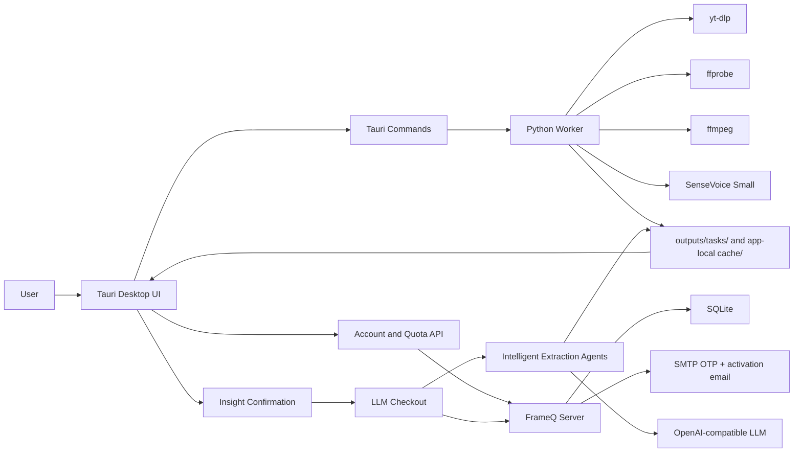

# FrameQ

<div align="center">

**The open-source, local-first answer to Google NotebookLM — for video and web sources.**

<sub>开源版 Google NotebookLM · 本地优先 · 视频与网页即来源</sub>

Paste a video link, a web page, or a local media file. FrameQ keeps it on your machine, transcribes it, and turns it into a searchable notebook with summaries, mindmaps, and grounded insight prompts.

[](LICENSE)
[](#frameq-vs-google-notebooklm)

[](https://tauri.app/)
[](https://react.dev/)
[](https://docs.astral.sh/uv/)
[](https://www.modelscope.cn/)
[](https://fastify.dev/)

</div>

---

## Overview

**FrameQ is an open-source alternative to Google NotebookLM.** NotebookLM turns the documents you upload into a grounded notebook; FrameQ does the same job for the sources that NotebookLM cannot handle well — video links, web pages, and local media — and it does the heavy lifting on your own machine instead of in a cloud pipeline.

> 一句话：**把视频、网页和本地音视频变成你的本地笔记库**——转写、摘要、思维导图、要点与解剖都在本机完成，只有你确认的 AI 步骤才会把文字发出去。

Paste a supported public or authorized video link, a public web page, or pick a local video/audio file. FrameQ coordinates the local worker to download the media, extract audio, transcribe speech with SenseVoice Small, and save a note you can reopen, search, collect, and export. Summary, mindmap, insight-topic, transcript-dissection, and draft generation are separate, explicitly confirmed steps that use the server-managed LLM checkout and quota flow.

> [!NOTE]
> Latest stable release: **v0.5.1** (Windows x64, macOS Intel, macOS Apple Silicon), published 2026-11-09. See [GitHub Releases](https://github.com/jiabai/FrameQ/releases).
>
> Licensed under **Apache-2.0**. The desktop client, worker, and server all live in this repository.

```text
Public or authorized video link / web page / local media file
  -> yt-dlp download or system WebView extraction (20-minute download budget)
  -> ffprobe media validation
  -> ffmpeg 16 kHz mono audio extraction
  -> SenseVoice Small local transcription
  -> saved note with transcript, in a collection you control
  -> optional confirmed summary, mindmap, insight topics, dissection, and draft
```

> [!IMPORTANT]
> FrameQ is for public videos, videos you own, or videos you are authorized to process. It is not designed to bypass platform access controls, login walls, CAPTCHA, copyright restrictions, or privacy boundaries.

## Contents

- [Download Latest Release](#download-latest-release)
- [FrameQ vs Google NotebookLM](#frameq-vs-google-notebooklm)
- [Why FrameQ](#why-frameq)
- [Current Capabilities](#current-capabilities)
- [Supported Inputs and Outputs](#supported-inputs-and-outputs)
- [Architecture](#architecture)
- [Quick Start](#quick-start)
- [Desktop Release Runtime](#desktop-release-runtime)
- [Desktop Local Settings](#desktop-local-settings)
- [Server Deployment](#server-deployment)
- [Worker Smoke Test](#worker-smoke-test)
- [Repository Map](#repository-map)
- [Quality Gates](#quality-gates)
- [Security Boundary](#security-boundary)
- [Source of Truth](#source-of-truth)

## Download Latest Release

Grab the newest installer from **[GitHub Releases → latest](https://github.com/jiabai/FrameQ/releases/latest)**.

| Platform | Asset |
| --- | --- |
| Windows x64 | `FrameQ_0.5.1_x64-setup.exe` (also `.sig`, used by the in-app updater) |
| macOS Apple Silicon | `FrameQ_0.5.1_aarch64.dmg` |
| macOS Intel | `FrameQ_0.5.1_x64.dmg` |

Each release also carries `latest.json` for the Tauri updater and the on-demand `frameq-pytorch-runtime-*.zip` components. The macOS builds are ad-hoc signed, not notarized — see [macOS install and Gatekeeper](#macos-install-and-gatekeeper) for the one-time approval step.

## FrameQ vs Google NotebookLM

NotebookLM popularized the "give it your sources, get a grounded notebook back" loop. FrameQ is the **open-source version of that idea**, rebuilt around two constraints NotebookLM does not have: your media stays local, and video is a first-class source rather than an afterthought.

| Capability | Google NotebookLM | FrameQ |
| --- | --- | --- |
| License and hosting | Proprietary, cloud-only | **Apache-2.0**, desktop app you install and run |
| Video as a source | Accepts some video URLs as a text source | **Full local pipeline**: download, `ffprobe`, audio extraction, local ASR, timestamped transcript |
| Web pages | Supported as a text source | Supported: public page body extracted through a system WebView into a local note |
| Local media files | Not uploadable as media | Video/audio file from disk, transcribed locally |
| Where media is processed | Uploaded to Google | **On your machine.** Video, audio, transcripts and model caches stay in app-local storage |
| Transcription | Cloud ASR | **SenseVoice Small, local**, ONNX runtime in the installer |
| Grounded artifacts | Audio/video overviews, mindmaps, reports, study aids | Summary, Mermaid mindmap, insight topics, transcript dissection, platform-style draft |
| Source-grounded chat | Yes, with citations | **Not yet** — FrameQ generates artifacts rather than answering follow-up questions |
| Multi-source synthesis | Many sources in one notebook | One source per note; collections group notes but do not cross-analyze them |

Honest boundary: FrameQ is not a feature-for-feature clone. It covers the *source → transcript → notebook → grounded artifacts* path and adds local media processing; it does not yet ship an audio overview, a chat surface, or cross-document reasoning. See [Current Capabilities](#current-capabilities) for exactly what exists today.

## Why FrameQ

| Principle | What it means |
| --- | --- |
| Local-first processing | Videos, audio, transcripts, model caches, and local history stay on the user's machine by default. |
| Open source, no lock-in | Apache-2.0, desktop client + worker + server in one repository. Nothing you process is tied to a vendor account, and the AI steps can be skipped entirely. |
| Notebook-shaped, not a downloader | Every processed source becomes a local note with a transcript, grouped into collections and surfaced under artifacts, so results stay reusable instead of being one-off exports. |
| Clear workflow states | The UI shows video extraction, transcription, insight generation, completion, partial completion, or failure. |
| Result entry points | Completed tasks expose video, audio, transcript, summary, transcript-dissection, insight-topic, and generated-draft cards. Video, audio, and transcript entries locate their saved files directly; locating the transcript is blocked while edits are unsaved. |
| Two-stage AI generation | Download, audio extraction, and transcription run first. Summary, transcript dissection, mindmap, insight topics, and draft generation require a separate confirmation and quota check. |
| Recoverable results | If AI generation fails, the transcript remains available and the user can retry only the AI step. |
| Auditable project structure | Product specs, architecture notes, design rules, security boundaries, execution plans, and validation scripts are tracked in the repository. |

## Current Capabilities

- Tauri + React + TypeScript desktop client.
- Python worker managed by `uv`.
- One home composer for three source types: a public/authorized video link, a public web page, or a single local video/audio file. Choosing a file does not start processing; submission stays explicit.
- Notebook-style local library: a sidebar with Home, Notes, Collections, and Artifacts, pinned notes, rename/add-to-collection/copy-source/open-source/note-info/delete actions, and a searchable note list backed by real local history.
- Automatic LLM note titles generated after the transcript is saved (one additional AI Credit), localized to the submission language, with an explicit retry when title generation fails.
- Public/authorized video download through `yt-dlp`, with focused fallback paths for Douyin, Xiaohongshu, and ordinary Bilibili videos. A download child process carries a 20-minute budget, so a stalled transfer ends as a retryable download failure instead of hanging.
- Web page notes: a system WebView loads the public page, extracts the body, and saves it as a local Markdown note with source URL and extraction time. Web notes hide audio, timestamps, and video actions, and skip media title generation.
- Xiaohongshu platform-subtitle reuse: when a public note carries one validated Chinese or English subtitle track, the worker writes it as the transcript and skips local ASR; a missing or rejected track falls back to the unchanged local ASR path.
- Media validation with `ffprobe`.
- Audio extraction with `ffmpeg`.
- Selectable local ASR models (SenseVoiceSmall-ONNX default, SenseVoiceSmall optional) with on-demand, resumable download into app-local data. The ONNX runtime ships in the installer; the PyTorch runtime is a separate 140 MB component downloaded on demand.
- agent_runtime-based intelligent extraction: `summary_agent`, `topic_agent`, `dissection_agent`, and `draft_agent` produce the summary, insight topics, transcript dissection, and draft artifacts.
- Transcript dissection (`文字稿解剖`) AI target for traceable structural review of a saved transcript, with explicit cloud-text disclosure and bounded per-run quota.
- Draft generation (`生成文字稿`) AI target that turns one selected insight into a platform-style draft through server-managed anysearch retrieval and a platform skill. The transcript, video, audio, and source URL never enter the draft prompt, and the result is written to `ai/draft.md` with the pre-edit copy kept under `ai/original/`.
- Server-managed account, activation-code monthly pass entitlement, self-service activation-email requests for inactive or expired desktop accounts, LLM checkout, and insight quota service.
- Browser-side per-user Web dashboard (`/dashboard`) with email-OTP login, plus per-page `zh-CN` / `en` / `zh-TW` switching on the `/login`, `/dashboard`, `/admin/login`, and `/admin` pages.
- User-initiated, local-only desktop diagnostic export of the most recent seven days from the failure UI and Settings. Douyin share-page retries are recorded as fixed log entries, so a run that only succeeded after a retry is distinguishable from a first-try success.
- Windows installer preflight: free-space and writability checks before any files are written, one Chinese failure message naming the cause and the log path, and a step log at `%TEMP%\FrameQ-install.log`. Silent installs record the same steps without blocking.
- Motion-enhanced UI with reduced-motion support (processing stage, task state, ASR download progress, AI target, and history list).
- Exported artifacts:
  - `outputs/tasks/<task_id>/media/video.mp4`
  - `outputs/tasks/<task_id>/media/audio.wav`
  - `outputs/tasks/<task_id>/transcript/transcript.txt`
  - `outputs/tasks/<task_id>/transcript/transcript.md`
  - `outputs/tasks/<task_id>/ai/summary.md`
  - `outputs/tasks/<task_id>/ai/mindmap.mmd`
  - `outputs/tasks/<task_id>/ai/insights.json`
  - `outputs/tasks/<task_id>/ai/insights.md`
  - `outputs/tasks/<task_id>/ai/dissection.json`
  - `outputs/tasks/<task_id>/ai/dissection.md`
  - `outputs/tasks/<task_id>/ai/draft.md`
  - `outputs/tasks/<task_id>/ai/original/draft.md`
  - app-local `cache/tasks/<task_id>/` for temporary downloads and scratch files

## Supported Inputs and Outputs

| Area | Supported today |
| --- | --- |
| Input workflow | One source at a time: a public or user-authorized video link, a public web page, or a local video/audio file. FrameQ is a local notebook for that source, not a general downloader or batch queue |
| Local media files | One video or audio file picked from disk; transcribed locally without any network download |
| Public web pages | Any page a system WebView can load without login, paywall, or CAPTCHA; the body is extracted into a Markdown note with its source URL and UTC extraction time |
| Douyin public videos | Long links, short links, share text, `/note/{id}`, `/share/slides/{id}`, `modal_id`, and `aweme_id` inputs when they resolve to a playable public video |
| Xiaohongshu public video notes | Share text, direct note IDs, full `xiaohongshu.com/explore/{note_id}` links, `xhslink.com` / `www.xhslink.com` short links, and `xhslink.cn` / `www.xhslink.cn` short links. A validated platform subtitle track is reused when present; otherwise the note goes through local ASR |
| Bilibili ordinary public videos | BV links, av links, selected `?p=N` parts, and safe `b23.tv` short links that resolve to ordinary `/video/` pages |
| YouTube public single videos | `youtube.com/watch?v=...`, `youtu.be/...`, and `youtube.com/shorts/...`; `watch?v=...&list=...` is processed as one video with playlist context ignored |
| Transcript output | Plain text and Markdown |
| AI output | Summary Markdown, Mermaid mindmap, insight JSON, insight Markdown, a transcript-dissection report in both JSON and Markdown, and a generated draft in Markdown |
| Video, audio, and transcript viewing | Locate generated files in the system file manager |

> [!NOTE]
> Platform links may still fail if they are expired, private, region-blocked, login-gated, CAPTCHA-gated, age-restricted, member-only, DRM-protected, or otherwise unavailable to the local worker. FrameQ does not provide platform login, browser-cookie import, proxy setup, stream picking, batch queues, or a download center.

## Architecture



Runtime boundary: the app must not import code from outside this repository's `server/`. Intelligent extraction agents (`summary_agent`, `topic_agent`, `dissection_agent`, `draft_agent`) live inside `worker/worker_core/`.

## Quick Start

Install development dependencies:

```powershell
uv sync --dev
Push-Location app; npm install; Pop-Location
Push-Location server; npm install; Pop-Location
```

Run focused checks:

```powershell
uv run ruff check worker
uv run pytest worker/tests
npm --prefix app test
npm --prefix server test
```

Build the frontend:

```powershell
npm --prefix app run build
```

Build the desktop app without bundling an installer:

```powershell
npm --prefix app run tauri -- build --no-bundle
```

The built executable is written to:

```text
app/src-tauri/target/release/app.exe
```

The desktop app keeps its local state in `%LOCALAPPDATA%\com.frameq.desktop` (`~/Library/Application Support/com.frameq.desktop` on macOS). When you want a recovery point before a dev run:

```powershell
npm --prefix app run tauri:dev:safe    # snapshot first, then start the dev app
npm --prefix app run snapshot:appdata  # snapshot only
```

Snapshots go to `build/appdata-snapshot/<timestamp>/` and the five most recent are kept. Only `.env`, `ui-preferences.json`, `auth/`, and the JSON records under `outputs/` are copied; model caches, the WebView profile, and media files are excluded.

## Desktop Release Runtime

Installed builds run the bundled Python worker directly and set `APP_ALLOW_REAL_ASR=1` automatically. Release builds default to SenseVoiceSmall-ONNX, whose runtime ships in the installer; the model cache is downloaded on first run into app-local data. Selecting the PyTorch SenseVoice Small model additionally requires the runtime component, offered from the model sheet.

Build unsigned internal installer resources and package:

```cmd
set APP_PYTHON_STANDALONE_URL=D:\archives\python-build-standalone.tar.zst
set APP_FFMPEG_ARCHIVE_URL=D:\archives\ffmpeg-release.zip
node scripts\build-installer.mjs --target windows-x64
```

The Python and ffmpeg values may be URLs or local archive paths. Use `--target windows-x64`, `--target macos-arm64`, or `--target macos-x64` on the matching build machine. The installer build copies runtime files into `app/src-tauri/resources/`, then runs `tauri build`. Large generated resources stay out of git.

The installer does not bundle SenseVoice Small weights, and it does not bundle the PyTorch ASR runtime either: `funasr`, `torch`, and `torchaudio` live in the `pytorch` extra of `pyproject.toml`, and the build script exports the bundled runtime without extras. It prunes non-runtime Python debug, cache, test, and header artifacts; keeps `resources/models` out of the bundle; and guides the user through downloading `iic/SenseVoiceSmall-onnx` into app-local data on first run. Upgrades from a settings file that still held the old PyTorch default are moved to the ONNX model once, and the settings sheet explains the change with a dismissible notice.

The same build also assembles the PyTorch runtime component: it installs `uv export --no-dev --extra pytorch` into a standalone `site-packages/`, removes every distribution the bundled runtime already provides (matched by METADATA name, files located via each dist's RECORD), writes a `runtime-manifest.json` carrying the `uv.lock` SHA-256 fingerprint, and packs `frameq-pytorch-runtime-<target>.zip`. The CI jobs upload that zip to the GitHub release next to the installer; the desktop downloads it on demand and the worker compares fingerprints before injecting it into `sys.path` (see `worker/worker_core/runtime_component.py`).

On the macOS Intel (`macos-x64`) build, the newest versions of some native dependencies ship no prebuilt x86_64 wheel — `llvmlite` (reached through `librosa` → `numba`, shared by both ASR runtimes) is the notable one, and building it from source needs a matching LLVM install the runners lack. The build therefore pins `numba`/`llvmlite` to the last releases with self-contained macOS x86_64 wheels (see the pins in `pyproject.toml`), and installs with `pip install --only-binary=llvmlite` so a missing wheel fails loudly instead of falling back to a source build that would bake in Homebrew paths (for example `/usr/local/opt/zstd/lib/libzstd.1.dylib`) and break on clean user Macs.

Two build-time checks then confirm the packaged runtime is self-contained, and together they need no clean Mac:

- `scripts/verify-macos-self-contained.mjs` runs inside the installer build (both arches) and fails if any bundled library references a non-bundled path (`/usr/local`, `/opt/homebrew`, `/opt/local`). This is static analysis, so it catches leaks even on the Homebrew-rich runner where an import smoke test would pass.
- The release workflow then imports the packaged runtime from the built `.app` (`import funasr_onnx, modelscope, onnxruntime, yt_dlp; import worker_core`) with `PYTHONDONTWRITEBYTECODE=1`, and checks that `runtime-manifest.json` made it into the bundle. This fails if a required library did not make it into the bundle before the DMG is uploaded. The workflow and DMG script also reject `__pycache__` / `.pyc` files and run `codesign --verify --deep --strict` before packaging, because writing bytecode after Tauri signs the `.app` invalidates the bundle and makes downloaded apps appear damaged in Gatekeeper.

### GitHub Releases updater artifacts

FrameQ desktop uses Tauri signed updater artifacts hosted on GitHub Releases. The bundled updater endpoint is:

```text
https://github.com/jiabai/FrameQ/releases/latest/download/latest.json?frameq-updater=1
```

The GitHub Actions workflow `.github/workflows/desktop-release.yml` prepares the bundled runtime resources, builds the Windows NSIS installer, uploads updater artifacts, uploads `latest.json` for Tauri updater checks, and uploads separate macOS Intel / Apple Silicon DMG assets. Configure these repository secrets before running it:

```text
APP_PYTHON_STANDALONE_URL
APP_FFMPEG_ARCHIVE_URL
APP_PYTHON_STANDALONE_URL_MACOS_X64
APP_FFMPEG_ARCHIVE_URL_MACOS_X64
APP_FFPROBE_ARCHIVE_URL_MACOS_X64
APP_PYTHON_STANDALONE_URL_ARM64
APP_FFMPEG_ARCHIVE_URL_ARM64
APP_FFPROBE_ARCHIVE_URL_ARM64
TAURI_SIGNING_PRIVATE_KEY
TAURI_SIGNING_PRIVATE_KEY_PASSWORD
```

The `APP_PYTHON_STANDALONE_URL` / `APP_FFMPEG_ARCHIVE_URL` pair is used only by the Windows job. Each macOS job requires its own architecture-specific archives and does not fall back to the Windows secrets: set `APP_PYTHON_STANDALONE_URL_MACOS_X64`, `APP_FFMPEG_ARCHIVE_URL_MACOS_X64`, and `APP_FFPROBE_ARCHIVE_URL_MACOS_X64` for the Intel DMG job, and `APP_PYTHON_STANDALONE_URL_ARM64`, `APP_FFMPEG_ARCHIVE_URL_ARM64`, and `APP_FFPROBE_ARCHIVE_URL_ARM64` for the Apple Silicon job. Both macOS jobs use split media archives: point the `..._FFMPEG_ARCHIVE_URL_...` secret at the ffmpeg archive and the `..._FFPROBE_ARCHIVE_URL_...` secret at the ffprobe archive. A missing macOS secret fails the build instead of silently reusing Windows runtime inputs.

> [!IMPORTANT]
> `APP_PYTHON_STANDALONE_URL_MACOS_X64` must be a **CPython 3.11 or 3.12** standalone. The `pytorch` extra pins `torch==2.2.2` on Intel (the last PyTorch release with macOS x86_64 wheels), which publishes wheels only up to CPython 3.12 (cp312). A 3.13+ standalone has no matching `torch==2.2.2` wheel, so the Intel job fails when the build script installs the PyTorch component. The installer's launcher setup is CPython-minor-agnostic, so this torch pin is the only Python-version constraint. Apple Silicon and Windows track modern torch and are not affected.

Create or update a release by pushing a `v*` tag or running the workflow manually with a tag such as `v0.1.0`. Manual runs can disable `build_windows_updater`, `build_macos_x64`, or `build_macos_arm64` when patching only one release asset. Draft releases are useful for inspection, but updater clients only resolve `releases/latest/download/latest.json?frameq-updater=1` after the release is published as a non-draft, non-prerelease release.

Release operators can override the default ModelScope download source:

```powershell
$env:APP_ASR_MODEL_DOWNLOAD_URL = "https://cdn.example.com/frameq/sensevoice-small-cache.zip"
$env:APP_ASR_MODEL_DOWNLOAD_SHA256 = "expected-sha256"
$env:APP_MODELSCOPE_ENDPOINT = "https://www.modelscope.cn"
$env:APP_SENSEVOICE_REVISION = "master"
```

The custom archive must contain:

```text
models/iic/SenseVoiceSmall/model.pt
models/iic/speech_fsmn_vad_zh-cn-16k-common-pytorch/model.pt
```

LLM API keys, cloud model credentials, ASR weights, and user-private configuration are never packaged into the installer.

The workflow validates and rewrites the uploaded `latest.json` as UTF-8 without BOM before the final release-asset upload, because Tauri updater rejects updater manifests with a BOM as invalid JSON. The bundled updater endpoint includes a fixed query string to avoid stale GitHub release-asset cache entries after a manifest is corrected in place.

### macOS install and Gatekeeper

The macOS DMGs (both Intel and Apple Silicon) are **ad-hoc signed but not notarized**. Ad-hoc signing is free and needs no Apple Developer ID certificate; it re-seals the bundled Python, ffmpeg, and worker resources so the app and its libraries load correctly. It does **not** clear Apple notarization, so the first launch after downloading is still blocked once by Gatekeeper. Ask users to approve it a single time:

The approved v0.2.16 policy permits this distribution only for personal development, a small user
group, or an open-source tool with prominent disclosure. It must not be described as Developer ID
signed, notarized, App Store reviewed, or suitable for silent enterprise deployment. A broader
consumer/commercial release that removes the manual Gatekeeper step still requires Developer ID
signing and notarization.

- **macOS 15 Sequoia and later:** double-click the app once, dismiss the warning, then open **System Settings → Privacy & Security**, scroll to the FrameQ message, and click **Open Anyway**.
- **macOS 14 and earlier:** Control-click (right-click) the app in `/Applications` and choose **Open**, then confirm **Open** in the dialog.
- **Terminal fallback (any version):** remove the download quarantine attribute directly.

  ```bash
  xattr -dr com.apple.quarantine /Applications/FrameQ.app
  ```

Removing this one-time prompt entirely requires an Apple Developer Program membership plus notarization, which is intentionally deferred until the desktop app proves commercial demand. Until then, ad-hoc signing keeps the failure mode to a bypassable prompt rather than the non-recoverable "app is damaged" error, as long as the signed `.app` is not modified after signing. See `docs/exec-plans/tech-debt-tracker.md` for the removal condition.

macOS updates are manual for the same reason: the Tauri updater only publishes Windows artifacts and a Windows-only `latest.json`, so the desktop app reports macOS update delivery as manual (`get_update_delivery`). On macOS the app skips the silent update check and the settings sheet shows a **前往下载页** action that opens the releases page, instead of the Windows in-app auto-update flow. Re-download the newer DMG to update.

## Desktop Local Settings

The desktop app stores non-LLM local settings in its app-local data `.env` file. The settings sheet creates this file when needed, shows its path, and can reveal it in the system file manager.

This file is for local output, ASR, and model-download settings only. Insight-topic LLM configuration is managed on the FrameQ server and is not read from desktop `.env` files. Do not put `APP_LLM_*` keys in desktop `.env`; legacy local LLM keys are ignored by the desktop worker.

## Server Deployment

The `server/` service handles account login, activation-code monthly pass entitlement, self-service activation-code email delivery, and server-managed LLM checkout. Inactive or expired desktop accounts can request a code by email through `POST /api/desktop/activation-codes/request`; the request is authenticated first, accepts only `locale`, returns only `status`, `retry_at`, and `redeem_by`, and never returns the plaintext code. `GET /api/desktop/account` now advertises the additive `can_request_activation_code` capability so newer clients can show the request action while older clients continue working unchanged.

Self-service rollout is Server-first and fail-closed:

- `APP_SELF_SERVICE_ACTIVATION_ENABLED` must be explicitly `true` or `false` in production and accepts `0`/`1` as false/true; development and test default to `false`.
- The feature is unavailable unless SMTP is configured; missing SMTP or partial SMTP configuration is a production startup failure, and there is no console fallback for activation-code email.
- Request eligibility is enforced on the Server: only a valid desktop session whose entitlement is missing or expired can request a code.
- Successful requests are cooled down by persisted dispatch limits: one per email per 60 seconds, five per email per fixed hour, and twenty per trusted client IP per fixed hour. Rate-limited responses return `retry_at` and `Retry-After`.
- Self-service codes are account-bound and move through `pending_delivery -> active -> redeemed|expired|disabled`. `pending_delivery` codes fail closed and cannot redeem. SMTP acceptance activates the code, supersedes older active self-service codes for that same account, and a later active entitlement disables any waiting pending code with `activation_became_active`.
- Each successful self-service redemption starts a fresh 31-day entitlement window from `now` and resets quota to `llmQuotaLimit=20` / `llmQuotaUsed=0`. Expired accounts can repeat the cycle without a lifetime cap; active entitlements cannot pre-renew or stack.

Production domain:

```text
https://frameq.8xf.pro
```

Deployment files:

| File | Purpose |
| --- | --- |
| `deploy/server-deployment.md` | Production deployment runbook |
| `deploy/nginx/frameq-server.conf` | Nginx reverse proxy for `frameq.8xf.pro` |
| `deploy/nginx/frameq-proxy-headers.conf` | Shared proxy headers snippet |
| `deploy/systemd/frameq-server.service` | systemd service example |

Recommended production shape:

```text
Nginx :443 on frameq.8xf.pro
  -> FrameQ server 127.0.0.1:8787
      -> server/data/frameq.sqlite
```

The server uses SQLite, so run a single FrameQ server instance against a given database.

Server checks:

```powershell
npm --prefix server run build
npm --prefix server test
```

Local server schema setup uses the same reviewed migration chain as production:

```powershell
npm --prefix server run prisma:generate
npm --prefix server run db:migrate:deploy
npm --prefix server run db:migrate:status
npm --prefix server run db:preflight -- --mode current
```

The reviewed migration chain is:

```text
202607220001_baseline
202607220002_auth_quota_hardening
202608030001_user_session
202608240001_self_service_email_activation
202608240002_auth_rate_limit_self_service_purpose
202608240003_self_service_active_unique
202610100001_anysearch_config
202610290001_remove_entitlement_status
202611080001_remove_wechat_billing
```

Production rollout and rollback checklist:

- Deploy the reviewed migration chain and Server code with `APP_SELF_SERVICE_ACTIVATION_ENABLED=false`.
- Verify SMTP delivery, `/health/live`, `/health/ready`, `GET /api/desktop/account`, the request route, and the Admin Web activation-code audit table before enabling the flag.
- Turn the feature on only after the desktop build that understands `can_request_activation_code` is available.
- If rollback is needed, switch the flag off first, then restore the matched code/database/config set per `deploy/server-deployment.md`.

See [the production runbook](deploy/server-deployment.md) before migrating, backing up, restoring,
or rolling back a deployed SQLite database.

## Worker Smoke Test

Retry intelligent extraction from an existing transcript without rerunning download or ASR:

```powershell
$env:PYTHONPATH = "$PWD\worker"
@'
import json
from pathlib import Path
from worker_core.worker_service import retry_insights_once

result = retry_insights_once(
    json.dumps({
        "task_id": "<existing-safe-task-id>",
        "target": "insights",
        "output_language": "zh-CN",
    }),
    project_root=Path.cwd(),
)
print(json.dumps({
    "status": result["status"],
    "insights_count": len(result["insights"]),
    "insights_path": result["artifacts"].get("insights"),
}, ensure_ascii=False, indent=2))
'@ | uv run python -
```

Tauri passes the JSON argument directly. For manual shell smoke tests, stdin scripts avoid PowerShell JSON quoting issues.

## Repository Map

| Path | Role |
| --- | --- |
| `app/` | Tauri + React + TypeScript desktop client |
| `server/` | TypeScript Fastify account, activation-code monthly pass entitlement, self-service activation email, and LLM-checkout service |
| `worker/` | Python worker for download, media validation, audio extraction, ASR, and intelligent extraction |
| `deploy/` | Server deployment runbook plus Nginx and systemd reference configs |
| `outputs/` | Task-owned videos, transcripts, summaries, mindmaps, insight files, and task manifests |
| app-local `cache/` | Temporary downloads, scratch files, and rebuildable task cache |
| `models/` | Local ASR model cache |
| `docs/` | Architecture, design, security, product specs, and execution plans |
| `AGENTS.md` | AI collaboration entry map |
| `WORKFLOW.md` | Project workflow rules |
| `TASKS.md` | Current recovery/task checkpoint |

## Quality Gates

Before claiming a change is complete:

```powershell
uv run python scripts/validate_agents_docs.py --level WARN
uv run ruff check worker
uv run pytest worker/tests
npm --prefix app test
npm --prefix app run build
npm --prefix server test
npm --prefix server run build
cargo test --manifest-path app/src-tauri/Cargo.toml
```

For desktop release validation:

```powershell
npm --prefix app run tauri -- build --no-bundle
```

## Security Boundary

- FrameQ is for public videos, user-owned videos, or videos the user is authorized to process.
- FrameQ does not implement bypasses for platform login walls, access controls, CAPTCHA, or privacy restrictions.
- The account service stores email accounts, OTP metadata, session token hashes, activation-code records, entitlements, encrypted LLM config, and quota events.
- Self-service activation email derives the destination strictly from the authenticated session. Plaintext codes live only in one email-sending process memory window and the outbound email; they are excluded from logs, Admin HTML, desktop IPC responses, diagnostics, and local UI persistence.
- The self-service path has no console delivery fallback. Missing SMTP keeps the capability unavailable, and production requires full SMTP configuration before startup succeeds.
- Activation-code persistence is hash-only. Self-service rows add source, bound account, delivery metadata, and disabled reason, with a partial unique index allowing at most one active self-service code per account.
- Persisted self-service rate limits use the same reviewed database-backed window policy as OTP dispatch: 60 seconds per email, 5 per email per fixed hour, and 20 per trusted client IP per fixed hour.
- The account service must not receive video files, audio files, transcripts, generated insights, cookies, model caches, or local history contents.
- If insight topic generation is enabled, transcript text may be sent to the server-managed OpenAI-compatible LLM provider.
- Real `.env` files, SQLite databases, backups, logs, model caches, output files, and secrets stay out of git.

## Source of Truth

- Product specs: [docs/product-specs/](docs/product-specs/)
- Architecture: [docs/ARCHITECTURE.md](docs/ARCHITECTURE.md)
- Design rules: [docs/DESIGN.md](docs/DESIGN.md)
- Security boundary: [docs/SECURITY.md](docs/SECURITY.md)
- Execution plans: [docs/exec-plans/](docs/exec-plans/)
