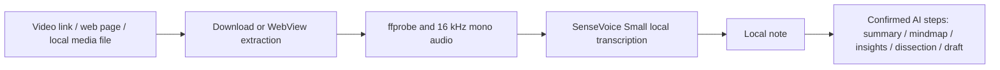

# Locus

<div align="center">

**The open-source, local-first answer to Google NotebookLM — for video and web sources.**

<sub>开源版 Google NotebookLM · 本地优先 · 视频与网页即来源</sub>

Paste a video link, a web page, or a local media file. Locus keeps it on your machine, transcribes it, and turns it into a searchable notebook with summaries, mindmaps, and grounded insight prompts.

[](LICENSE)
[](#locus-vs-google-notebooklm)

</div>

---

## Overview

**Locus is an open-source alternative to Google NotebookLM.** NotebookLM turns the documents you upload into a grounded notebook; Locus does the same job for the sources NotebookLM cannot handle well — video links, web pages, and local media — and does the heavy lifting on your own machine instead of in a cloud pipeline.

> 一句话：**把视频、网页和本地音视频变成你的本地笔记库**——下载、转写与文字稿留在本机；摘要、思维导图、要点与解剖由你确认后调用云端 AI 生成。

> [!NOTE]
> Latest stable release: **v0.6.1** (Windows x64, macOS Intel, macOS Apple Silicon), published 2026-11-11. See [GitHub Releases](https://github.com/jiabai/Locus/releases). Licensed under **Apache-2.0**; the desktop client, worker, and server all live in this repository.



> [!IMPORTANT]
> Locus is for public videos, videos you own, or videos you are authorized to process. It does not bypass platform login walls, CAPTCHA, DRM, copyright restrictions, or privacy boundaries.

## Download

Grab the newest installer from **[GitHub Releases → latest](https://github.com/jiabai/Locus/releases/latest)**.

| Platform | Asset |
| --- | --- |
| Windows x64 | `Locus_0.6.1_x64-setup.exe` (plus `Locus_0.6.1_x64-setup.exe.sig` for the in-app updater) |
| macOS Apple Silicon | `Locus_0.6.1_aarch64.dmg` |
| macOS Intel | `Locus_0.6.1_x64.dmg` |

Releases also carry `latest.json` for the Windows updater and on-demand `pytorch-runtime-*.zip` components for the optional PyTorch ASR model. macOS builds are ad-hoc signed, not notarized: the first launch needs a one-time **System Settings → Privacy & Security → Open Anyway**.

> [!WARNING]
> The account service runs at `locus.8xf.pro`. Releases up to v0.6.0 have the previous domain compiled in, so they can no longer sign in or use Locus-managed AI steps. v0.6.0 receives the fix through the in-app updater; v0.5.1 and earlier need a manual reinstall. Local state from earlier installs is not migrated: the current data directory is `%LOCALAPPDATA%\pro.8xf.app`.

## Locus vs Google NotebookLM

| | Google NotebookLM | Locus |
| --- | --- | --- |
| License / hosting | Proprietary, cloud-only | **Apache-2.0**, an app you install and run |
| Sources | Uploaded documents, some video URLs | Video links, public web pages, local media files |
| Where media is processed | Uploaded to Google | **On your machine** — media, transcripts, model caches stay local |
| Transcription | Cloud ASR | **SenseVoice Small, local** |
| Grounded artifacts | Overviews, mindmaps, reports, study aids | Summary, Mermaid mindmap, insight topics, transcript dissection, platform-style draft |
| Source-grounded chat | Yes, with citations | **Not yet** — Locus generates artifacts, not follow-up answers |
| Multi-source synthesis | Many sources in one notebook | One source per note; collections group notes but do not cross-analyze |

Honest boundary: Locus is not a feature-for-feature clone. It covers the *source → transcript → notebook → grounded artifacts* path and adds local media processing; it does not ship an audio overview, a chat surface, or cross-document reasoning.

## What it does

- One home composer for three inputs: a public/authorized video link, a public web page, or one local video/audio file.
- Local notebook with a sidebar (Home / Notes / Collections / Artifacts), pinned notes, search, rename, collections, and export.
- Video download through `yt-dlp` with focused Douyin / Xiaohongshu / Bilibili fallbacks and a 20-minute per-download budget; valid Xiaohongshu platform subtitles are reused instead of running ASR.
- Web pages loaded in a system WebView and saved as local Markdown with source URL and extraction time.
- Selectable local ASR models (SenseVoiceSmall-ONNX default; PyTorch optional with an on-demand ~140 MB runtime).
- Separately confirmed AI steps — summary, mindmap, insight topics, transcript dissection, platform-style draft — using Locus-managed models with quota checkout by default, or your own OpenAI-compatible provider (BYOK). BYOK keys are stored only in the operating system keychain, and those steps need no sign-in or AI Credit; platform-style drafts still use server-managed search and require a signed-in account. A failed AI step leaves the transcript intact and can be retried alone.
- Automatic LLM note titles, a per-user Web dashboard with email-OTP login, and a local-only diagnostic export.
- Windows installer preflight for free space and writability, with a step log at `%TEMP%\install.log`.

One source at a time; this is a local notebook, not a general downloader or batch queue. Platform links may still fail when they are private, expired, region-blocked, login-gated, or otherwise unavailable. Full capability and artifact lists live in [docs/product-specs/](docs/product-specs/) and [docs/ARCHITECTURE.md](docs/ARCHITECTURE.md).

## Why Locus

| Principle | What it means |
| --- | --- |
| Local-first | Videos, audio, transcripts, model caches, and history stay on your machine. |
| Open source | Apache-2.0; desktop client, worker, and server in one repository; the AI steps can be skipped entirely. |
| Notebook, not a downloader | Every source becomes a reusable local note instead of a one-off export. |
| Two-stage AI | Download and transcription run first; each AI step needs a separate confirmation, and Locus-managed steps also check quota. |

## Quick Start

```powershell
uv sync --dev
Push-Location app; npm install; Pop-Location
Push-Location server; npm install; Pop-Location
npm --prefix app run tauri -- dev
```

Before claiming a change is complete, run the full gate set (see [docs/EXECUTION_GATES.md](docs/EXECUTION_GATES.md)):

```powershell
uv run python scripts/validate_agents_docs.py --level ERROR
uv run python scripts/validate_agents_docs.py --level WARN
uv run ruff check worker
uv run pytest worker/tests
npm --prefix app test
npm --prefix app run lint
npm --prefix app run build
npm --prefix server test
npm --prefix server run build
cargo test --manifest-path app/src-tauri/Cargo.toml
node --test scripts/tests/*.test.mjs
python -m pytest scripts/tests
```

Build without packaging an installer with `npm --prefix app run tauri -- build --no-bundle`; the executable lands at `app/src-tauri/target/release/app.exe`. Local state lives in `%LOCALAPPDATA%\pro.8xf.app`.

## Repository Map

| Path | Role |
| --- | --- |
| `app/` | Tauri + React + TypeScript desktop client |
| `worker/worker_core/` | Python worker: download, media validation, ASR, and the Studio AI tools (summary, mindmap, insights, dissection, draft) |
| `server/` | Fastify account, entitlement, and LLM-checkout service |
| `contracts/` | Cross-language task and artifact contracts |
| `deploy/` | Production runbook plus Nginx and systemd reference configs |
| `site/` | Marketing site (gitignored, deployed separately) |
| `docs/` | Product specs, design docs, security, execution plans |
| `AGENTS.md` / `WORKFLOW.md` / `TASKS.md` | Collaboration map, workflow rules, task ledger |

## Security Boundary

- Only public, owned, or authorized sources; no login-wall, CAPTCHA, DRM, or privacy bypasses.
- Only explicitly confirmed AI steps may send transcript text to an LLM: Locus-managed steps go through the server-managed provider and quota checkout, while BYOK steps go to the OpenAI-compatible endpoint you configure. The account service never receives media, transcripts, insights, cookies, model caches, or local history.
- API keys for custom providers stay in the operating system keychain; they are never written to config files, logs, command-line arguments, or diagnostic exports.
- Real `.env` files, SQLite databases, backups, logs, model caches, outputs, and secrets stay out of git.

Full boundary: [docs/SECURITY.md](docs/SECURITY.md).

## Documentation

| Topic | Where |
| --- | --- |
| Product specs | [docs/product-specs/](docs/product-specs/) |
| Architecture and design | [docs/ARCHITECTURE.md](docs/ARCHITECTURE.md) · [docs/DESIGN.md](docs/DESIGN.md) |
| Security | [docs/SECURITY.md](docs/SECURITY.md) |
| Execution plans and hard gates | [docs/exec-plans/](docs/exec-plans/) · [docs/EXECUTION_GATES.md](docs/EXECUTION_GATES.md) |
| Server deployment | [deploy/README.md](deploy/README.md) · [deploy/server-deployment.md](deploy/server-deployment.md) |
| Release workflow | [.github/workflows/desktop-release.yml](.github/workflows/desktop-release.yml) |
