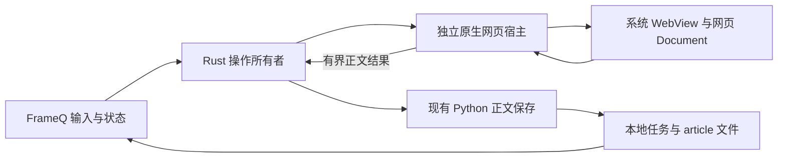

# 系统 WebView 网页正文提取

状态：原生宿主、正文交接与组件退役已实现；Windows真实验证、回归、默认构建及启动完成，macOS实际验证保留为发行门禁。

已确认要求：复用系统 WebView，不额外下载 Chromium；读取真实网页正文，保存本地笔记，保持既有页面与智能提炼范围。
本设计按普通网页读取功能使用平台原生能力，不增加系统网络过滤扩展。
官方依据及平台限制见[能力核查](../references/2026-11-02-system-webview-capabilities.md)。

## 组成与职责



- 主应用只负责输入、阶段、取消、保存、历史与阅读；远程页面在独立 helper 中运行。
- Windows helper 直接使用 WebView2 COM；macOS helper 使用 AppKit/WebKit。
- helper 不初始化 Tauri，不安装主应用 IPC、asset scheme、插件、host objects 或页面消息处理器。
- 提取脚本由原生接口在隔离 JavaScript world 执行，通过原生 completion 返回正文；网页脚本不能提交保存命令或任务路径。
- Rust 保有 operation、session、主导航 generation、deadline、数据许可和任务许可；Python 只接收已验证正文，调用现有原子保存。

## 平台宿主

### Windows

使用系统 Stable Evergreen Runtime，最低版本为当前 bindings 对应的 143.0.3650.58；逐项查询实际 COM 接口能力。
本机 156.0.4314.58 已通过真实静态和 JavaScript 页面提取、保存与历史重开，以及加载取消后再次保存和独占目录清理。
缺失、过旧或能力不足返回明确错误，不启动网页组件下载。

每个任务新建独占 UDF、Environment 和 InPrivate Controller。创建隐藏 HWND 与非零 viewport，安装所有设置、
事件、页面失败处理及父进程监督后才导航。UDF 实际路径必须匹配本次 cache 目录身份；对环境或注册表造成的
不安全 Runtime/UDF/debug 配置覆盖返回错误，不修改用户的系统配置。

关闭 web messages、host objects、自动填充、保存密码、单点登录、开发工具、默认对话框和上下文菜单。
所有原生 permission request 返回 deny；新窗口、外部 URI、下载、HTTP 认证和客户端证书请求均取消，证书错误不接受。
用原生 CDP 创建主 frame 的隔离 world；不开放调试端口。回调与当前 frame/context/generation 一致才能采用。

### macOS

使用 macOS 14 及以上的系统 WKWebView。每个任务创建新的 nonPersistent data store、configuration、content controller
和隐藏的独立页面。专用 helper `.app` 使用自身 bundle identifier 与 App Sandbox 签名，仅授予必要的外连权限；
不授予主应用文件、用户选择文件、应用组、共享凭据、设备或定位权限，也不使用继承主应用权限的 entitlement。

在 load 前为新 data store 设置现有 Rust HTTP CONNECT 代理，关闭 failover，使用空排除列表。
危险导航、新窗口、下载、上传、相机/麦克风及脚本对话框由相应原生 delegate 拒绝或取消。
HTTP/代理登录和客户端证书请求取消；`NSURLAuthenticationMethodServerTrust` 使用 `performDefaultHandling`，
保留系统 TLS 证书校验和错误拒绝，不接受无效证书或降级 TLS。
专用 WKContentWorld 中的固定提取代码只读取 DOM 和克隆文档，不调用页面提供的函数。

App Sandbox 身份、实际 entitlement、独立数据容器和主应用文件访问拒绝均必须对最终打包 helper 实测。
当前 Windows 环境仅完成源码及打包配置核查，macOS 编译、最终签名和运行行为尚未验证。

## 网页网络与限额

输入只接受既有规则允许的 HTTP(S) URL。主导航和可观察的子请求拒绝显式本地、保留地址、危险 scheme 及受限端口。
DNS 检查拒绝包含非公网结果的解析；没有原生连接绑定的路径不宣称能够防止 DNS 变化。
Windows 的 NavigationStarting 只作同步 URI/导航次数检查；需要异步 DNS 时在有 deferral 的资源事件中提交有界
`policy_check`，Rust 回复对应 `policy_decision`。拒绝、超时或取消必须设置明确阻断 response 再完成 deferral；
允许的请求继续由原生网络处理。不能把没有设置 response 的 Complete 当成阻断。

| 控制 | Windows | macOS |
| --- | --- | --- |
| 网页 HTTP 网络 | 保留系统 WebView2 原生网络、Cookie、CORS 和重定向语义；通过 `_22` 的资源事件检查可观察请求 | WKWebView 原生网络；HTTP(S) 使用独立 data store 的任务代理 |
| 代理实际目标地址 | 无稳定公开代理接口；不依赖 browser flags 提供权限保证 | 经过 Rust 代理的连接执行全答案 DNS 检查并固定已验证 IP |
| HTTP 请求调度 | 最多16个DNS检查在途，最多512个资源排队；累计数量不限制页面 | 代理最多16条活动连接，在接受新连接前等待名额，额外连接由系统监听队列背压 |
| 流量 | CDP已完成请求的encodedDataLength累计最多64MiB；在完成事件检查，不能覆盖未完成/失败请求的全部已收字节或保证下载前限额；阻止媒体、图片和字体请求 | 代理可见流量最多64MiB、最多16条并发连接；CONNECT连续5秒没有实际字节传输时释放名额，不将其称作全部网络流量 |
| 主导航 | 最多 5 次重定向，最终原生 URL 重新准入 | 相同；子资源重定向不套用主导航计数 |
| 全部私网流量 | 公开接口不足以保证所有传输路径均被阻止 | WebRTC 可绕过 HTTP 代理，公开 API 没有完整关闭选项 |

系统 WebView 方案不提供操作系统级网络防火墙保证。网页可能使用资源事件或 HTTP 代理之外的网络能力；
对这些路径的真实测量必须记录，不能用 JavaScript 删除网络对象、页面最终报错或相机权限拒绝来冒充拦截成功。
普通原生页面加载保留浏览器自己的 Cookie/CORS 行为，不实现自定义 Cookie 同步和 HTTP response 代理。

共同硬限额：准备就绪 15 秒，导航 60 秒，整个操作 90 秒；DOM 8 MiB/100,000 节点，正文 2 MiB、Markdown 4 MiB、
标题 512 字符。连续三次 500 ms 采样稳定后提取；单次提取回调 2 秒未返回则使 session 失效并关闭宿主。
这些是结果接收与自有宿主期限，不能解释为 macOS 全部系统 WebKit 进程的 CPU 截止。

## 提取、保存与取消

继续使用 `app/src/articleExtraction/` 的 Readability、DOMPurify、Turndown/GFM 和现有许可证。
固定代码在隔离 world 读取真实 Document，返回 title/text/markdown；Rust 从原生最终 URL 生成安全 sourceUrl。
网页返回的 URL 不参与授权或保存路径。Markdown 的本地阅读继续使用当前安全渲染器。

保留 `begin_web_page` 的 null ACK、Pending 登记和长请求认领。移除全部组件 begin/prepare/cancel 命令。
Rust 每次提取前后检查 `(operation_id, session_id, navigation_generation)`；取消先使该组合失效，晚到回调不能进入保存。

私有保存请求使用版本2：

```typescript
type SaveWebPageRequestV2 = {
  contract_version: 2;
  operation_id: string;
  task_id: string;
  article: { title: string; sourceUrl: string; text: string; markdown: string };
};
```

task_id 由 Rust 预分配并写入本次操作收据，Python 使用这一 ID 创建新的网页任务。
原子发布后、stdout 返回前中断时，只按该收据中的 task ID 恢复并核验，报告真实已保存结果或明确失败。
不得扫描相似标题或网址来猜测保存结果。

宿主协议、保存 stdin 和相关 stdout 均设独立 40 MiB 编码上限；字段仍受原始 UTF-8 上限约束。
该限额包含 JSON 转义，其他 worker 操作继续当前请求限额。使用成熟 JSON 实现解析，超限立即失败。
宿主协议版本为1，operation/session使用规范小写UUID；父进程核验并记录helper及Windows browser身份后发送 `start`，
宿主才开始导航。提取脚本最多2 MiB，来自同一已读取并完成哈希核验的固定bundle。
宿主初始化字段按平台封闭：Windows 只额外获得本次 UDF 路径，Mac 只额外获得本次代理地址；
Mac helper 不获得主应用配置或任务目录路径。请求策略判定最多16个在途、512个排队；排队最多10秒，实际检查最多2秒。
主文档目标危险时终止；附属请求独立阻断，DNS失败、检查超时分别保留真实错误类别。检查已超时的在途请求占用原名额直到父进程回复，避免两端计数不一致。
队列容量耗尽报告资源超限，排队超时报告检查超时。主文档导航完成后，提取仍等待当前正文相关检查结束及DOM稳定；正文不存在或受访问限制时失败。
Windows通过已启用的原生CDP Network事件等待文档、脚本、样式、XHR及Fetch真实完成或失败，最多跟踪1024个在途请求。提取回调期间出现相关加载变化时丢弃候选并重新采样，每代只发布一次提取阶段。图片、媒体、字体、Ping不参与正文加载等待；未结束的XHR/Fetch仍受整体期限约束。主页面HTTP401/403/407明确报告访问受限，其余非2xx报告HTTP失败。
macOS的公开delegate覆盖导航和子框架策略，代理覆盖HTTP连接与字节；无法观察HTTPS隧道内每个XHR完成，因此原生didFinish和DOM稳定仍有此平台差异。
宿主stderr最多16条封闭原因/资源类别诊断，Rust只接受白名单字段并写入本地日志；不得包含网址、域名、正文或Cookie。
阶段仅由真实事件驱动：加载网页、提取正文、保存笔记；保存阶段由 worker 的真实提交事件开始。

## 生命周期与恢复

Windows 先 Stop/Close Controller，等待匹配 browser PID 的 BrowserProcessExited；无响应时终止已验证归属的任务进程。
JobObject、COM process group 和原生 PID/创建时间/文件身份共同用于归属确认。只统计可确认归属的 RSS；系统共享服务
不进入任务终止集合。确认不了自有进程或 UDF 清理时，保留收据并使用现有资料库恢复状态。

macOS 停止加载、解除 delegates、释放 view/data store 后退出 helper；Rust 能终止并等待自有 helper 与保存 worker。
WebKit XPC 的全部 PID、总 RSS 和精确释放时限没有相应公开接口。它们交由系统管理，不套用独立进程组全量回收保证。
主应用只在自有 helper/worker 已结束、代理已关闭、晚到结果失效且自有缓存处理完成后报告取消完成。

父进程观察到本次工作完成、取消或失败后，宿主与缓存清理共用独立 15 秒期限。90 秒工作期限结束后不接收新结果，
进入真实清理；清理失败保留资料并进入恢复提示。macOS 系统 WebKit 服务不纳入自有进程清理时限。
关闭、退出、重启共用现有准入屏障，尚未取得数据许可的 Claim 也参与等待。

已有独立组件资料和旧收据按原有类型识别。停止下载、执行和探测旧引擎；不自动递归删除已安装组件或用户缓存。
旧 `.frameq-web-pages` 收据仍按其原协议恢复。新宿主使用 `cache/.frameq-system-webviews/<operation_id>/` 与 schema1
所有权记录，保存收据包含预分配任务ID、规范来源、标题及正文哈希；禁止猜测未知目录的所有权。
迁移保留旧 baseline 的 `readyWebEngine` 可选字段以兼容控制文件，仅取消其启动探针，仍执行库存和文件核验。

## 决策与验收

采用普通系统 WebView 的页面执行、Cookie/CORS 和权限模型，以独立原生 helper 隔离主应用。
没有新增系统过滤扩展、HTTP 代理浏览器实现、页面 JavaScript 消息桥或浏览器下载流程。
完整私网拦截、全部网络流量配额及所有系统进程的强制回收不作为本设计承诺。

Windows 必须使用实际安装的 WebView2 验证静态/动态正文、无 IPC/文件/账号访问、权限拒绝、取消、崩溃、无限脚本和 UDF 清理。
macOS 必须对最终签名 helper 验证相同功能与 Sandbox、代理、XPC 行为并记录差异；没有对应机器时标记未验证，保留发行门禁。
两平台均回归既有网页笔记、媒体、合集、迁移和 AI 来源契约；付费供应商调用继续遵守用户本次跳过的选择。

本轮已读取的系统宿主证据为 Windows 静态/动态正文、正式文件与历史重开、加载取消及下一任务、原生宿主退出和 UDF 清理。
权限、账号/文件、认证、私网、WebSocket/WebRTC 等 canary 需要独立实测，不能沿用旧独立 Chromium 的验证结论。
完整结果和最终构建状态维护在[完成记录](../exec-plans/completed/2026-11-02-system-webview-extraction-plan.md)。
