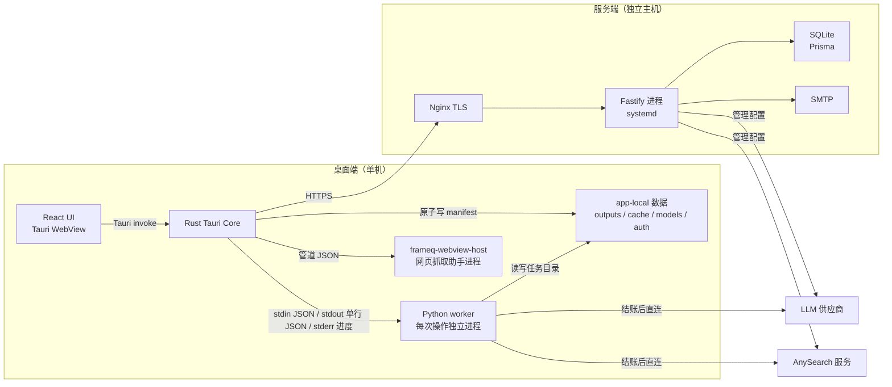
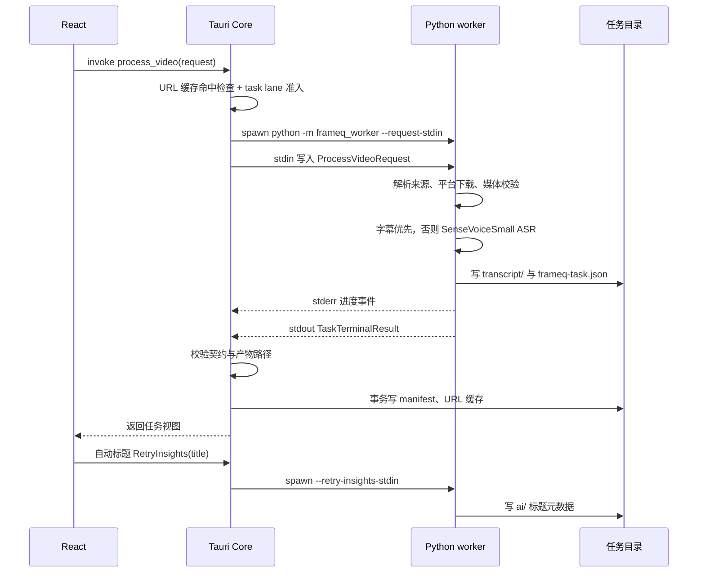
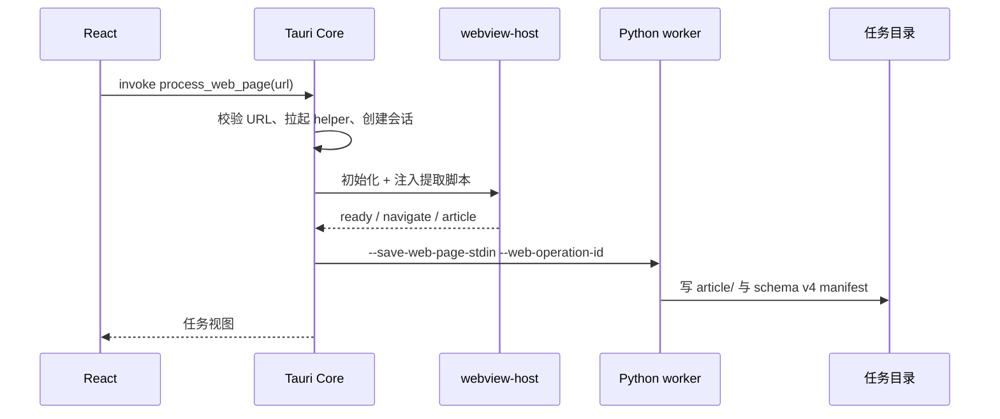
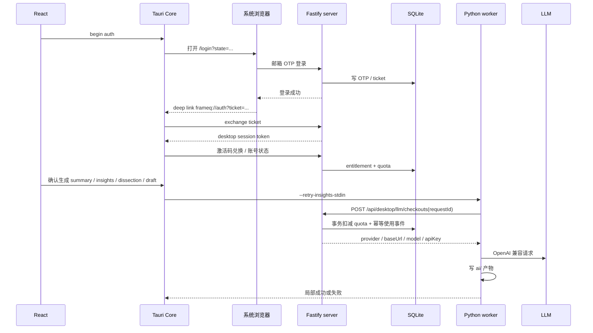

# FrameQ 架构与核心链路说明

- 日期：2026-11-07
- 适用版本：桌面端 `0.5.0`（[tauri.conf.json](../../app/src-tauri/tauri.conf.json#L4)），desktop-worker contract `11`
- 核对基线：工作区当前代码与 `docs/ARCHITECTURE.md`、`AGENTS.md`、`README.md`、`TASKS.md`、`docs/exec-plans/tech-debt-tracker.md`
- 本文目标：让没有接触过本仓库的人，按文档顺序读完后能定位每条主链路的入口、产物和边界

## 1 顶层目录

| 路径 | 职责 | 归属 | 事实依据 |
| --- | --- | --- | --- |
| `app/` | Tauri 宿主 + React/TypeScript 界面。所有桌面功能的第一入口 | 主线 | [AGENTS.md](../../AGENTS.md#L15-L20)、[lib.rs](../../app/src-tauri/src/lib.rs#L108-L190) |
| `worker/` | Python worker：下载、媒体校验、音频提取、ASR、网页保存、工作间 | 主线 | [cli.py](../../worker/frameq_worker/cli.py#L120-L191)、[pipeline_runtime/orchestration.py](../../worker/frameq_worker/pipeline_runtime/orchestration.py#L106-L250) |
| `server/` | Fastify + Prisma + SQLite：账号、OTP、激活码、额度、LLM/AnySearch 结账、后台页 | 主线 | [server.ts](../../server/src/server.ts#L135-L184)、[schema.prisma](../../server/prisma/schema.prisma#L1-L120) |
| `contracts/` | 跨语言契约：desktop-worker、网页保存、网页宿主、任务产物事务、平台 URL 支持 | 主线共用边界 | `contracts/*.json`（5 个文件） |
| `scripts/` | 文档校验、版本检查、安装包构建、开发辅助 | 支撑 | [AGENTS.md](../../AGENTS.md#L38-L40) |
| `deploy/` | 服务端 runbook、Nginx 与 systemd 参考配置 | 支撑 | `deploy/server-deployment.md`、`deploy/nginx/`、`deploy/systemd/` |
| `docs/` | 架构边界记录、产品规格、设计决策、执行计划、发布记录 | 支撑 | `docs/` 共 311 个文件 |
| `site/` | Astro 营销站与下载页。版本号唯一来源是 `site/src/consts.ts` | 周边，未纳入 git | [.gitignore](../../.gitignore)、[AGENTS.md](../../AGENTS.md#L22-L24) |
| `lib-external/` | `EasyDownload`、`videodl` 等外部下载实现的阅读参考，运行期禁止 import | 周边，未纳入 git | [AGENTS.md](../../AGENTS.md#L26-L29) |
| `design-system/` | 营销站设计参考；仅 `README.md`、`apple-DESIGN.md`、`globals.css` 入库 | 周边 | [AGENTS.md](../../AGENTS.md#L31-L33) |
| `video/` | Remotion 宣传视频工程 | 周边，未纳入 git | [AGENTS.md](../../AGENTS.md#L24) |
| `build/` | 安装包构建缓存（Deno、npm） | 本地缓存 | [AGENTS.md](../../AGENTS.md#L30) |
| `models/` | 本地 ASR 模型缓存 | 本地数据 | [AGENTS.md](../../AGENTS.md#L34) |
| `outputs/` | 任务产物：视频、音频、文字稿、总结、脑图、灵感与 task manifest | 本地数据 | [AGENTS.md](../../AGENTS.md#L35) |
| `work/` | 冒烟测试临时日志 | 本地残留 | 目录存在，未在 `AGENTS.md` 目录地图中 |
| `data/` | 顶层空目录 | 本地残留 | 目录存在，未在 `AGENTS.md` 与 `.gitignore` 中出现 |
| `nonexistent/` | 测试用路径残留 | 本地残留 | 目录存在，未在 `AGENTS.md` 中出现 |

`app/`、`worker/`、`server/` 是必须同时理解的三条主线。`contracts/` 是它们之间的强制边界，`docs/` 是决策与历史记录，其余目录不参与运行期调用。

## 2 系统形态与部署

### 2.1 进程与通信

桌面端只有 1 个常驻应用进程。Python worker 不常驻，按任务启动；网页抓取另有独立 helper 进程；ASR 模型下载走单独的 worker lane。服务端是单个 Fastify 进程加一个 SQLite 文件，部署形态见 [server-deployment.md](../../deploy/server-deployment.md)。

### 2.2 部署方式

| 端 | 打包/部署 | 关键事实 |
| --- | --- | --- |
| Windows 安装包 | Tauri NSIS + 内置 Python 运行时与 worker 资源 | 安装包约 269 MB、解压约 1081 MB、36588 个文件；由 `docs/exec-plans/tech-debt-tracker.md` 记录 |
| macOS 安装包 | DMG，ad-hoc 签名 | 未 notarize；`TASKS.md` 的 v0.5.0 残余风险列出 macOS 图形验收与 Intel 验收工作流 |
| 服务端 | Nginx 终止 TLS，转发到 `127.0.0.1:8787`；systemd 常驻；启动前跑 Prisma 迁移检查 | [runtimeConfig.ts](../../server/src/runtimeConfig.ts#L69-L73)、[deploy/nginx/locus-server.conf](../../deploy/nginx/locus-server.conf)、[deploy/systemd/locus-server.service](../../deploy/systemd/locus-server.service) |
| SQLite | 单文件数据库，单实例写入；备份要求停服务 | `deploy/server-deployment.md` |
| 营销站 | 静态 Astro 构建后手工部署；`site/` 不进 git | [AGENTS.md](../../AGENTS.md#L22-L24)、[site/src/consts.ts](../../site/src/consts.ts#L33) |

### 2.3 通信协议

| 边界 | 方式 | 约束 |
| --- | --- | --- |
| React → Rust | `invoke("<command>")` | 76 个命令，按 `web_page`、`data_storage`、`local_media`、`video_processing`、`settings`、`history`、`account` 等分组，见 [lib.rs](../../app/src-tauri/src/lib.rs#L108-L190) |
| Rust → Python | 命令行选模式，请求体走 stdin，终态走 stdout 单行 JSON，进度走 stderr | 请求 JSON 不进入 argv，避免路径、URL、token 出现在进程列表；见 [command.rs](../../app/src-tauri/src/worker_runtime/command.rs#L284-L304) |
| Rust → 网页 helper | 管道上的 JSON 消息 | helper 自带 manifest、SHA-256 校验与平台白名单，见 [native_webview_host.rs](../../app/src-tauri/src/worker_runtime/native_webview_host.rs#L11-L49) |
| Rust → server | HTTPS + `Authorization: Bearer <desktop session token>` | 只发送账号、激活码、结账与状态查询 |
| Worker → server | HTTPS 结账接口 | 只发 `requestId` 与目标，不回传文字稿、音频、提示词 |
| Server → LLM/AnySearch | 服务端持有管理密钥；结账时解密后返回给桌面 | 见 [desktopLlm.ts](../../server/src/routes/desktopLlm.ts#L24-L73) |

## 3 核心链路

### 3.1 视频链接 → 文字稿 → 本地任务

链路入口与控制点：

1. 前端在 [useTaskProcessingController.ts](../../app/src/features/workflow/useTaskProcessingController.ts#L89-L113) 中提交，先用 `canProcessWithAccount` 判断激活状态。
2. Rust 侧 `process_video` 在 [video_processing/url_processing.rs](../../app/src-tauri/src/video_processing/url_processing.rs) 中做 URL 规范化、缓存命中、lane 准入与进程启动。
3. 命令模式由 [command.rs](../../app/src-tauri/src/worker_runtime/command.rs#L284-L304) 决定：`--request-stdin`、`--process-local-media-stdin`、`--retry-insights-stdin`、`--resolve-source-stdin`、`--save-web-page-stdin`。
4. Python 侧 [cli.py](../../worker/frameq_worker/cli.py#L120-L191) 解析模式，[worker_service.py](../../worker/frameq_worker/worker_service.py) 做请求校验，[pipeline_runtime/orchestration.py](../../worker/frameq_worker/pipeline_runtime/orchestration.py#L106-L250) 串起下载、媒体准备、转写与任务落盘。
5. 阶段枚举在 [models.py](../../worker/frameq_worker/models.py#L18-L30)：`waiting_input → video_extracting → video_translating → title_generating → completed/partial_completed/failed`。其中 `video_translating` 表示音频转文字，`translating` 是历史命名。
6. 文字稿先落盘，AI 总结不在同一次 worker 调用中生成。前端在任务成功后单独发起 `RetryInsights(title)`；标题生成失败会把整个任务标成 `partial_completed`，这是 [noteTitleSubmission.ts](../../app/src/features/workflow/noteTitleSubmission.ts) 与 [workflow.ts](../../app/src/workflow.ts) 的现有行为。

平台下载实现按站点拆分，`douyin`、`xiaohongshu`、`bilibili` 各有独立的 fallback 模块；通用路径在 `media.py`、`media_preparation.py`、`pipeline_runtime/orchestration.py`。字幕可用时优先使用平台字幕，否则调用本地 SenseVoice Small（ONNX 或 PyTorch）。

### 3.2 网页链接 → 本地笔记

关键事实：

- URL 准入在 [web_page_contract.py](../../worker/frameq_worker/web_page_contract.py#L11-L45)：仅 `http/https`，禁止内网/保留域/非全局 IP/内嵌凭据，长度上限 16384。
- 网页契约版本为 `2`，单消息上限 40 MiB，正文上限 2 MiB，Markdown 上限 4 MiB，见 [web_page_contract.py](../../worker/frameq_worker/web_page_contract.py#L11-L14)。
- helper 的 manifest 使用 `schema_version == 1`，二进制上限 128 MiB，启动前校验大小与 SHA-256，见 [native_webview_host.rs](../../app/src-tauri/src/worker_runtime/native_webview_host.rs#L26-L46)。
- 网页任务整体 watchdog 为 90 秒绝对超时，见 [watchdog.rs](../../app/src-tauri/src/worker_runtime/runner/watchdog.rs#L34-L37)。
- 网页任务使用独立 schema 版本 `4`，与视频任务 `3` 分开，见 [task_manifest.rs](../../app/src-tauri/src/task_manifest.rs#L18-L22)。
- 抓取链路只在本机运行，正文不会上传服务端；服务端只参与账号与 AI 结账。

### 3.3 账号、激活码、额度与 AI 生成

登录链路：`account.rs` 的 `begin_auth_flow` 打开系统浏览器，登录完成后通过深链接带回一次性 ticket；Rust 调 `/api/auth/desktop/exchange` 换取会话。原始 session token 存在 `auth/session.json`，服务端只存 SHA-256，见 [SECURITY.md](../../docs/SECURITY.md#L1075-L1076)。

账号门控：

- `canProcessWithAccount` 要求激活有效期内的 entitlement，视频转写与网页保存都过这一关。
- `canGenerateAiWithAccount` 额外要求剩余额度大于 0，AI 生成按钮使用这一门控。
- 自服务激活码先写 `pending_delivery`，SMTP 成功后才转 `active`；失败标记 `delivery_failed`，旧的待交付码标 `superseded`，见 [desktopAccount.ts](../../server/src/routes/desktopAccount.ts#L74-L126) 与 `prismaStore/selfServiceActivation.ts`。
- 自服务激活把额度重置为 20、有效期设为 31 天（`DEFAULT_ENTITLEMENT_DAYS`），兑换窗口 30 天；后台补偿码采用延长有效期与追加额度，两条策略在 [prismaStore/entitlements.ts](../../server/src/prismaStore/entitlements.ts) 中分开实现，常量见 [activationPolicy.ts](../../server/src/activationPolicy.ts#L9-L11)。

AI 结账：

- 每次 LLM 调用前单独结账，`requestId` 由 `target + 调用序号` 派生；服务端在同一事务里写使用事件并扣减额度，唯一键保证重放不会重复扣费，见 [prismaStore/entitlements.ts](../../server/src/prismaStore/entitlements.ts#L57-L117)。
- worker 侧 `max_retries = 0`，一次调用对应一次额度；多步生成与人工重试会消耗多次额度，见 [llm.py](../../worker/frameq_worker/llm.py) 与 [ai_runtime.py](../../worker/frameq_worker/ai_runtime.py)。
- 结账只发生在 AI 调用前，文字稿本身不需要 LLM 额度。
- `draft` 目标还会走 AnySearch 结账；该接口只校验会话，不扣额度，测试中明确写明“无配额、无可幂等消费对象”，见 [desktopLlm.ts](../../server/src/routes/desktopLlm.ts#L73-L90)。

## 4 关键抽象与设计取舍

### 4.1 契约优先与四份手工镜像

`contracts/desktop-worker-contract.json` 是桌面端与 worker 的共享契约，当前版本 `11`：

- [desktop-worker-contract.json](../../contracts/desktop-worker-contract.json#L1-L3) 的 `contractVersion`
- [desktop_contract.py](../../worker/frameq_worker/desktop_contract.py#L5-L10) 的 `DESKTOP_WORKER_CONTRACT_VERSION`
- [lib.rs](../../app/src-tauri/src/lib.rs#L65) 的 `DESKTOP_WORKER_CONTRACT_VERSION`

同一契约在四种语言里手工维护：

| 侧 | 文件 | 行数 |
| --- | --- | --- |
| JSON | `contracts/desktop-worker-contract.json` | 1946 |
| TypeScript 运行时校验 | [desktopWorkerProtocol.ts](../../app/src/desktopWorkerProtocol.ts) | 622 |
| Rust 终态校验 | [result_protocol.rs](../../app/src-tauri/src/worker_runtime/result_protocol.rs) | 1459 |
| Python 请求/进度校验 | [requests.py](../../worker/frameq_worker/requests.py)、[progress_events.py](../../worker/frameq_worker/progress_events.py) | 524 + 390 |

设计收益是闭集校验明确、失败码稳定、三端测试可对照。代价是每次契约变更要同步改 JSON、TypeScript、Rust、Python 与测试，仓库里没有 codegen。`progress` 的 `stage` 枚举故意不包含 `draft_generating`，而 `task.error.stage` 包含它，TypeScript 测试注释解释了原因：草稿生成属于局部动作，不进入全量任务的进度阶段。阅读契约时不能把两处枚举当成同一集合。

### 4.2 任务 manifest 是产物权威

- 每个任务目录含 `frameq-task.json`、`transcript/`、`ai/`、`article/`，视频任务另有 `video/`、`audio/`。
- 视频任务 schema `3`，网页任务 schema `4`，见 [task_manifest.rs](../../app/src-tauri/src/task_manifest.rs#L20-L22)。
- 允许的产物键是闭集，见 [schema.rs](../../app/src-tauri/src/task_manifest/schema.rs#L11-L27)：`video`、`audio`、`transcript_txt`、`transcript_md`、`article_txt`、`article_md`、`segments`、`summary`、`mindmap`、`insights`、`insights_md`、`preference_snapshot`、`dissection`、`dissection_md`、`draft`。
- 写入采用事务日志：worker 与 Rust 都实现 `.frameq-artifact-transaction.json`，固定 16 个目标路径，支持崩溃恢复，见 [transaction.rs](../../app/src-tauri/src/task_manifest/transaction.rs#L11-L38) 与 [task_transaction.py](../../worker/frameq_worker/task_transaction.py#L24-L65)。
- Rust 是 UI 读取产物的权威层：校验 worker 返回、拒绝敏感路径、原子提交 manifest，并把历史任务扫描成侧边栏数据。

### 4.3 进程监督与超时

| 操作 | idle 超时 | 绝对超时 |
| --- | --- | --- |
| 网页保存 | 无 | 90 秒 |
| 视频/本地媒体 | 45 分钟 | 8 小时 |
| AI 重试 | 30 分钟 | 90 分钟 |
| 来源解析 | 无 | 3 分钟 |
| 存储校验 | 无 | 3 分钟 |
| ASR 模型下载 | 10 分钟 | 4 小时 |

数据来自 [watchdog.rs](../../app/src-tauri/src/worker_runtime/runner/watchdog.rs#L30-L59)。`ProcessSupervisors` 只有 `task` 与 `asr_model_download` 两条 lane，见 [mod.rs](../../app/src-tauri/src/worker_runtime/mod.rs#L28-L32)；普通任务、网页、AI 重试共用 `task` lane，因此同一时刻只跑一个前台任务。取消会终止整个进程树，Windows 使用 Job Object，见 [supervisor.rs](../../app/src-tauri/src/worker_runtime/supervisor.rs)。

### 4.4 存储抽象与额度事务

服务端 `Store` 接口覆盖账号、OTP、session、激活码、订单、entitlement、LLM 配置、AnySearch 配置、rate limit 与后台会话，见 [store/contracts.ts](../../server/src/store/contracts.ts#L22-L428)。生产实现是 `PrismaStore`，测试实现是 `MemoryStore`；两者共用 `entitlements` 的业务操作，只在底层持久化上下文上分叉，见 [prismaStore.ts](../../server/src/prismaStore.ts#L11-L161) 与 [store/memory.ts](../../server/src/store/memory.ts#L28-L44)。

额度扣减使用带条件的更新与唯一使用事件，避免并发重复消费：

- `consumeLlmQuota` 在事务里先查 entitlement，再写 `LlmQuotaCheckout` 使用事件并递增 `llmQuotaUsed`。
- `(userId, requestId)` 唯一，重试同一请求返回已记录结果。
- SQLite 部署为单进程写入，生产不启用内存 Store。

### 4.5 本地优先与数据根

- 固定配置根保存 `auth/session.json` 与 `data-storage.json`（活动数据根、generation、迁移 receipt）；可迁移数据根保存 `outputs/`、`cache/`、`models/`、`runtime/`、`collections.json`，见 [control.rs](../../app/src-tauri/src/data_storage/control.rs#L22) 与 [runtime.rs](../../app/src-tauri/src/runtime.rs#L52)。
- 切换数据根前先跑 `storage_validation`，检查目标可写、可导入、组件版本与旧任务兼容性；迁移完成后旧目录按只读保留策略处理。
- 服务端只保存邮箱、OTP 元数据、session 哈希、激活码哈希/前缀、entitlement、管理员会话、LLM 配置元数据与额度事件，见 [SECURITY.md](../../docs/SECURITY.md#L1075-L1076)。
- 下载的媒体、文字稿、AI 产物、模型缓存都留在本机 `outputs/`、`models/`、`cache/`。

## 5 阅读顺序

按“先边界、再宿主、再实现”的顺序阅读，能最快建立可改代码的心智模型。

1. 规则与总览：`AGENTS.md`、`RULES.md`、`README.md` 的架构图与产物说明。
2. 现有代码审计：`docs/design-docs/code-audit-uml.md`。它提供模块清单、调用关系和风险清单，但基线是 contract `9`，阅读时以本文和当前代码为准。
3. 共享契约：[desktop-worker-contract.json](../../contracts/desktop-worker-contract.json#L1-L3)、[desktopWorkerProtocol.ts](../../app/src/desktopWorkerProtocol.ts)、[result_protocol.rs](../../app/src-tauri/src/worker_runtime/result_protocol.rs)、[requests.py](../../worker/frameq_worker/requests.py)、[progress_events.py](../../worker/frameq_worker/progress_events.py)。
4. Rust 宿主：[lib.rs](../../app/src-tauri/src/lib.rs#L73-L198)、[worker_runtime/runner.rs](../../app/src-tauri/src/worker_runtime/runner.rs)、[watchdog.rs](../../app/src-tauri/src/worker_runtime/runner/watchdog.rs)、[task_manifest.rs](../../app/src-tauri/src/task_manifest.rs)、[video_processing/url_processing.rs](../../app/src-tauri/src/video_processing/url_processing.rs)。
5. Worker：[cli.py](../../worker/frameq_worker/cli.py)、[worker_service.py](../../worker/frameq_worker/worker_service.py)、[pipeline_runtime/orchestration.py](../../worker/frameq_worker/pipeline_runtime/orchestration.py)、[media_preparation.py](../../worker/frameq_worker/media_preparation.py)、[media.py](../../worker/frameq_worker/media.py)、[asr_runtime/](../../worker/frameq_worker/asr_runtime)、[task_store.py](../../worker/frameq_worker/task_store.py)。
6. AI：[pipeline_runtime/insights.py](../../worker/frameq_worker/pipeline_runtime/insights.py)、[worker_application/insight_retry.py](../../worker/frameq_worker/worker_application/insight_retry.py)、[ai_runtime.py](../../worker/frameq_worker/ai_runtime.py)、[llm.py](../../worker/frameq_worker/llm.py)。
7. 前端：[App.tsx](../../app/src/App.tsx)、[useTaskProcessingController.ts](../../app/src/features/workflow/useTaskProcessingController.ts)、[useInsightGenerationController.ts](../../app/src/features/insightPreferences/useInsightGenerationController.ts)、`features/results/processingWorkspaceModel.ts`。
8. 服务端：[server.ts](../../server/src/server.ts#L135-L184)、[routes/desktopAuth.ts](../../server/src/routes/desktopAuth.ts)、[routes/desktopAccount.ts](../../server/src/routes/desktopAccount.ts)、[routes/desktopLlm.ts](../../server/src/routes/desktopLlm.ts)、[prismaStore/entitlements.ts](../../server/src/prismaStore/entitlements.ts)、[schema.prisma](../../server/prisma/schema.prisma)。

想改“处理阶段与进度”：先改契约 JSON、`JobStage`/进度校验、Rust `result_protocol`、前端阶段映射，再跑 `npm --prefix app test` 与 `uv run pytest worker/tests`。

想改“AI 产物”：先看 `insights.py` 的 target 分派与 `ai_runtime` 的结账语义，再改 manifest 产物键与前端读取。

想改“账号/额度”：先看 `store/contracts.ts` 与 `prismaStore/entitlements.ts`，再同步 `MemoryStore` 与路由测试。

## 6 明显问题与文档出入

### 6.1 README 版本号落后

[README.md](../../README.md#L22) 写“Latest stable release: v0.4.2”，当前桌面端与营销站都是 `0.5.0`：[tauri.conf.json](../../app/src-tauri/tauri.conf.json#L4)、[site/src/consts.ts](../../site/src/consts.ts#L33)、`TASKS.md` 的 v0.5.0 发布记录。新人按 README 找 release 会看到过期链接。

### 6.2 代码审计文档基线过期

[code-audit-uml.md](../design-docs/code-audit-uml.md) 写明基线为 2026-07-22、contract `9`，并把 `App.tsx` 记为 740 行；当前契约是 `11`，`App.tsx` 是 1103 行。它仍有很高的参考价值，但其中的模块行数、契约版本和调用关系不能直接当成当前事实。

### 6.3 ARCHITECTURE.md 是倒序边界日志

[docs/ARCHITECTURE.md](../ARCHITECTURE.md) 共 1542 行，最上方是较新的边界记录，下方保留 v4、v6、v10 等历史条目。它按“边界变更”追加，缺少一份覆盖当前全貌的单一章节。直接从头读会被历史契约版本干扰；按时间从新到旧读，或先读本文再定位具体边界，成本更低。

### 6.4 契约镜像的维护成本

契约 JSON 1946 行，配套的 TypeScript、Rust、Python 校验合计约 3000 行，全部手工维护且没有生成器。`task-artifact-transaction-v1.json` 的 16 个允许目标在 Rust 与 Python 里各自复制一份，注释写明“verbatim mirror”。这类同步在新增产物时最容易漏改一侧；现有测试能兜住大部分，漏改后通常到运行期校验才暴露，编译期看不出来。

### 6.5 前端组合根过大

[App.tsx](../../app/src/App.tsx) 现有 1103 行，承担路由外的所有页面装配、账号门控、任务恢复、设置与弹窗协调。多数流程已拆到 `features/*Controller`，但组合根仍然偏大。`docs/exec-plans/tech-debt-tracker.md` 已把剩余的装配逻辑列为接受项，改动时优先扩展 controller，避免继续在 App.tsx 中堆分支。

### 6.6 服务端 OTP 摘要强度

`server/src/security.ts` 对 OTP 使用裸 SHA-256，没有服务端 pepper 或 HMAC；验证码本身熵低且生命周期短，风险有限，但数据库泄露时可离线枚举。该问题已在 `tech-debt-tracker.md` 的中等优先级条目中登记。

### 6.7 下载命令没有硬超时

[media.py](../../worker/frameq_worker/media.py#L226) 的 `run_command` 调用外部 `yt-dlp`/`ffmpeg` 时不传 `timeout`，依赖 Rust 侧 45 分钟 idle watchdog 兜底。子进程只要持续输出进度，8 小时绝对上限才会触发。`tech-debt-tracker.md` 已登记为中等优先级，修改时需要同时保证字幕探测、平台 fallback 与取消语义不被破坏。

### 6.8 AnySearch 结账只鉴权不扣额度

[desktopLlm.ts](../../server/src/routes/desktopLlm.ts#L73-L90) 的 AnySearch 配置结账只要求有效会话，不检查 entitlement 或额度；测试注释写明“无配额”。这意味着任何已登录桌面会话都能取得由服务端管理的搜索凭据。设计上它只服务 draft 生成，但凭据接口本身没有额度和用途绑定，属于需要产品确认的滥用面。

### 6.9 标题生成会改变任务终态

视频文字稿完成后会自动发起 `RetryInsights(title)`，该调用消耗 1 次 LLM 额度；标题生成失败会把任务标成 `partial_completed`。这一行为在 `noteTitleSubmission.ts`、`workflow.ts` 与 `docs/product-specs/2026-10-31-llm-note-titles.md` 中是一致的，但对新人来说容易误判为转写失败。排查“文字稿正常却显示部分完成”时先看标题状态。

### 6.10 目录与本地缓存残留

- 顶层 `data/` 是空目录，未出现在 `AGENTS.md` 目录地图，也没有被 `.gitignore` 覆盖。
- `nonexistent/`、`work/`、`.worktrees/`、`.screenshots/`、`design-qa.md` 是本地测试或工具残留。
- `models/models--Qwen--Qwen3-ASR-0.6B/` 存在完整缓存，但 `worker/` 中没有任何 Qwen ASR 引用；当前登记模型只有 `iic/SenseVoiceSmall` 与 `iic/SenseVoiceSmall-onnx`，见 [model_download.py](../../worker/frameq_worker/model_download.py#L26-L28) 与 [progress_events.py](../../worker/frameq_worker/progress_events.py#L24-L26)。这份缓存属于本地实验残留，不参与运行。

### 6.11 双 Store 实现的漂移风险

`Store` 接口覆盖一整套账号、激活码、订单、额度与配置方法，`PrismaStore` 与 `MemoryStore` 各实现一遍，路由测试主要跑 MemoryStore。`entitlements` 已把业务逻辑抽到共享操作，降低了一部分漂移；激活码、session、rate limit、AnySearch 配置仍有各自的实现路径。修改额度或激活语义时，必须同时验证 Prisma 事务与内存行为。
