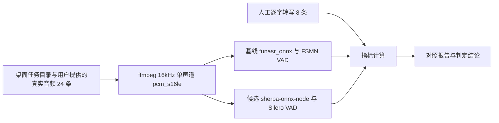

# ASR sherpa-onnx-node Spike Plan

> This ExecPlan is a living document. The sections Progress, Surprises & Discoveries, Decision Log, and Outcomes & Retrospective must be kept up to date as work proceeds.

## Purpose / Big Picture

用户提出把 `worker/` 的 Python 代码替换为 TypeScript。整个替换中唯一无法通过代码翻译消除的风险是 ASR 引擎：现有路径依赖 `funasr_onnx` 的 SenseVoiceSmall 与 FSMN 在线 VAD，TypeScript 侧没有对应实现。本计划用真实模型与真实音频测量 `sherpa-onnx-node` 能否承担这条路径，产出可复核的对照数据与明确结论。

用户在本计划执行期间看不到任何产品变化：桌面客户端、worker、契约与打包配置全部保持原样。全部测量产物存放在 `work/asr-spike/`，该目录已被 `.gitignore` 排除。用户音频与人工转写全程留在本机，不进入任何网络服务，本地优先与安全边界不受影响。

用户已确认分段边界允许变化，验收标准为识别质量不下降。

## Progress

- [x] 2026-11-12: 核实现有 ONNX ASR 路径的引擎、模型、VAD 分块、识别参数、文本清洗与音频归一化规格；核实 `sherpa-onnx-node` 的版本、平台预编译包、SenseVoice 配置字段、VAD 调用形态与模型来源；起草本计划并注册到 `active/index.md`。Validation: `uv run python scripts/validate_agents_docs.py --level ERROR` 与 `--level WARN` 均为 0 个错误 0 个警告；`.venv/Scripts/python.exe -m pytest worker/tests/test_sensevoice_onnx.py -q` 为 20 passed
- [x] 2026-11-12: 复核本计划引用的全部代码位置与外部事实：`registry.py:25`、`registry.py:29-32`、`sensevoice_onnx.py:24-25`、`sensevoice_onnx.py:80-135`、`sensevoice_onnx.py:187-195`、`sensevoice_onnx.py:241-245`、`sensevoice.py:21-22`、`sensevoice.py:104-114`、`sensevoice.py:260-281`、`media.py:210-224`、`pyproject.toml:11-37`、`pyproject.toml:53-60`、`tauri.conf.json:53-60`、`runtime.rs:110-142`、`contractVersion` 为 12，全部与正文一致；`worker/tests/` 实测 61 个文件、768 个 `def test_` 函数，无 `skipif` 与 `importorskip`。Validation: 逐文件读取比对；`Grep` 统计 `^def test_` 得 768 occurrences across 61 files
- [x] 2026-11-12: 核实语料与模型的实际存放位置，确定语料来源为桌面应用任务目录 `<APP_USER_DATA_DIR>/outputs/` 与用户提供的本机真实音频，并记录仓库 `models/` 实测 2.9GB。Validation: `ls -la outputs` 仅列出 `mcp-design-review`；`du -sh models` 得 2.9G；`Grep` 定位 `config.py:8` 与 `asr_model.rs:746`

## Surprises & Discoveries

Evidence: 现有默认 ASR 路径在 `worker/worker_core/asr_runtime/registry.py:25` 指定为 `SENSEVOICE_SMALL_ONNX_MODEL`，取值 `iic/SenseVoiceSmall-onnx`（`sensevoice_onnx.py:24`）。两个受支持模型同属 SenseVoice 家族（`registry.py:29-32`），因此候选引擎只需要覆盖 SenseVoice 一种模型结构。

Evidence: `sensevoice_onnx.py:187-195` 通过 `from funasr_onnx import SenseVoiceSmall` 与 `from funasr_onnx import Fsmn_vad_online` 加载引擎，两者均以 `quantize=True`、`device_id="-1"` 构造，ASR 另有 `batch_size=1`。fbank 特征提取在 `funasr_onnx` 内部完成，仓库自身没有特征提取代码。

Evidence: `sensevoice_onnx.py:25` 定义 `ONNX_VAD_CHUNK_SECONDS = 10`，`_stream_onnx_vad_segments`（`sensevoice_onnx.py:80-135`）按 10 秒分块喂入 VAD，在最后一块设置 `is_final`，并对毫秒事件流做严格校验，任何不符合起点终点交替顺序的事件都会触发 `ASRRuntimeError`。候选引擎的 Silero VAD 以 512 采样点为窗口、返回采样点偏移，事件模型与之不同。

Evidence: 识别调用在 `sensevoice_onnx.py:241-245` 使用 `language=_sensevoice_language(language)` 与 `textnorm="withitn"`。`_sensevoice_language`（`sensevoice.py:104-110`）把中文映射为 `zh`、英文映射为 `en`，其余全部映射为 `auto`。文本清洗使用正则 `<\|[^|>]+?\|>`（`sensevoice.py:22`、`sensevoice.py:113-114`）。

Evidence: 音频归一化命令在 `worker/worker_core/media.py:210-224`，参数为 `-vn -ac 1 -ar 16000 -c:a pcm_s16le`。`_read_pcm_wav_mono_float32`（`sensevoice.py:260-281`）用标准库 `wave` 读取并按 int16 除以 32768 转 float32。sherpa-onnx 的 SenseVoice 特征规格为采样率 16000、特征维度 80，与现有输出完全一致，候选路径无需重采样。

Evidence: `pyproject.toml:11-37` 的 macOS Intel 限制（`onnxruntime<1.24`、`numpy<2`、`llvmlite==0.45.1`、`numba==0.62.1`、`cryptography<49`）与 `pyproject.toml:53-60` 的 `pytorch` 可选依赖，全部来自 funasr 与 torch 的传递依赖。`sherpa-onnx-node` 的 `optionalDependencies` 提供 7 个平台预编译包：`sherpa-onnx-win-x64`、`sherpa-onnx-win-ia32`、`sherpa-onnx-win-arm64`、`sherpa-onnx-linux-x64`、`sherpa-onnx-linux-arm64`、`sherpa-onnx-darwin-x64`、`sherpa-onnx-darwin-arm64`，均为 2.0.1 版本，其中包含 macOS Intel。

Evidence: sherpa-onnx 官方文档明确 VAD 只支持 silero-vad 与 ten-vad，没有 FSMN VAD。Silero 配置字段为 `model`、`threshold`、`minSpeechDuration`、`minSilenceDuration`、`maxSpeechDuration`、`windowSize`，`maxSpeechDuration` 默认 20 秒。现有 torch 路径的 `SENSEVOICE_VAD_MAX_SEGMENT_TIME_MS` 为 30000（`sensevoice.py:21`），ONNX 路径未显式设置最长分段。

Evidence: SenseVoice 模型配置含 `model`、`language`、`use_itn` 三个字段，`language` 接受 `auto`、`zh`、`en`、`ko`、`ja`、`yue`，默认 `auto`。模型归档 `sherpa-onnx-sense-voice-zh-en-ja-ko-yue-int8-2024-07-17.tar.bz2` 含 `model.int8.onnx` 228MB 与 `tokens.txt` 308KB，上游说明该模型由 ModelScope `iic/SenseVoiceSmall` 导出，与现有模型同源。归档托管在 GitHub Releases 的 `asr-models` tag 下，`silero_vad.onnx` 为 629KB，位于同一 tag。

Evidence: `sherpa-onnx-node` 要求 Node >= v16，安装无需编译器、Python 或 CMake。Windows 的原生库位于 `node_modules` 内并自动定位；macOS 需要设置 `DYLD_LIBRARY_PATH` 指向 `$(npm root)/sherpa-onnx-node/lib`，Linux 需要设置 `LD_LIBRARY_PATH`。这一条直接影响 Tauri 子进程在 macOS 上的环境变量构造。

Evidence: `worker/tests/` 共 61 个测试文件、768 个测试函数，没有任何用例需要真实模型、网络或 ffmpeg 二进制，全部通过注入的替身运行。因此现有测试无法用于本次引擎对照，必须新建真实模型与真实音频的测量脚本。

Evidence: 仓库根目录的 `outputs/` 只含 `mcp-design-review` 一个目录，没有任务音频。桌面客户端的任务产物写入用户数据目录下的 `outputs`（`app/src-tauri/src/collections/tests.rs:73`、`:336`、`:388` 均以 `paths.user_data_dir.join("outputs")` 为任务根），worker 侧对应的环境变量为 `APP_USER_DATA_DIR`（`worker/worker_core/config.py:8`）。应用标识符为 `pro.8xf.app`（`app/src-tauri/tauri.conf.json:5`）。仓库根目录的 `models/` 为开发模式缓存，实测 2.9GB，其中 `models/onnx/` 存放 SenseVoice ONNX 模型；桌面客户端的模型根为用户数据目录下的 `models/onnx`（`app/src-tauri/src/asr_model.rs:746`）。

## Decision Log

Decision: 候选引擎确定为 `sherpa-onnx-node@2.0.1`，模型为 `sherpa-onnx-sense-voice-zh-en-ja-ko-yue-int8-2024-07-17` 的 `model.int8.onnx`，VAD 为 `silero_vad.onnx`。Rationale: 该包提供包含 macOS Intel 在内的 7 个平台预编译原生包；模型与现有 `iic/SenseVoiceSmall-onnx` 同源且同为 int8 量化，构成变量最小的对照；输入规格 16000Hz、80 维与现有 ffmpeg 输出一致。Date/Author: 2026-11-12 / User + QwenWork

Decision: 验收以字符错误率、漏句次数、重复循环次数与人工成对审查为准，分段边界与时间戳允许变化，仅测量偏差分布并设定上限。Rationale: 用户明确确认质量不下降即可，分段可变。Date/Author: 2026-11-12 / User

Decision: 语料取自桌面应用任务目录 `<APP_USER_DATA_DIR>/outputs/` 中已有任务的真实音频，不足部分由用户提供本机真实音频；人工逐字转写在本机完成，用户音频与转写不进入 CI。三平台加载验证在 CI 中只运行模型归档自带的 `test_wavs`。Rationale: 本地优先与安全边界禁止把用户音频发送到外部服务；平台加载验证只需要证明原生插件可用，模型自带音频足以完成。Date/Author: 2026-11-12 / QwenWork

Decision: 全部脚本、语料、转写与结果存放在 `work/asr-spike/`，不修改 `worker/`、`app/`、`contracts/`、`pyproject.toml` 与打包脚本。Rationale: `RULES.md` 要求中间结果存放在被 gitignore 的目录；本计划只做测量，测量结论用于后续独立立项。Date/Author: 2026-11-12 / QwenWork

Decision: 测量脚本采用 fast-fail，模型缺失、音频读取失败、识别结果为空一律在出错位置就地崩溃。Python 侧直接 import，不使用 try-except 包裹 import，不使用任何替身或伪造数据。Rationale: `RULES.md` 的强制行为规则；测量数据的可信度依赖真实执行。Date/Author: 2026-11-12 / QwenWork

## Outcomes & Retrospective

本计划已起草，测量尚未执行。交付目标为 `work/asr-spike/results/report.md` 中的对照数据与判定结论，以及回填到本文件的 Progress、Surprises & Discoveries 与验证记录。

Residual risk: 判定标准中的人工成对审查依赖人工判断，存在主观偏差；通过固定审查表格与记录具体差异原因降低影响。macOS Intel 与 Apple Silicon 的原生插件加载需要对应主机或托管 CI，本机无法覆盖；缺失平台记录为未验证残余风险。GitHub Releases 的国内下载速度随网络环境波动，单次测量不足以代表全部用户，需要同时记录镜像来源的可用性。

## Context and Orientation

worker ASR：

- `worker/worker_core/asr_runtime/registry.py` — 模型家族解析、缓存目录、transcriber 构造
- `worker/worker_core/asr_runtime/sensevoice_onnx.py` — 默认 ONNX 路径、FSMN 在线 VAD 状态机
- `worker/worker_core/asr_runtime/sensevoice.py` — torch 路径、音频读取、分段切分、文本清洗、语种映射
- `worker/worker_core/asr_runtime/types.py` — `Transcript`、`TranscriptSegment`、错误类型
- `worker/worker_core/asr_runtime/artifacts.py` — 文字稿产物写出

音频与模型：

- `worker/worker_core/media.py:210-224` — ffmpeg 音频归一化命令
- `worker/worker_core/config.py:8` — `APP_USER_DATA_DIR` 环境变量名
- `worker/worker_core/model_download.py` — ModelScope 模型下载与进度回调
- `worker/worker_core/runtime_component.py` — 外置运行时组件下载
- `app/src-tauri/src/asr_model.rs:746` — 桌面客户端模型根 `用户数据目录/models/onnx`

打包与运行时：

- `scripts/build-installer.mjs` — bundled Python 构建、ffmpeg 与 Deno 归档、运行时组件切分
- `app/src-tauri/tauri.conf.json:53-60` — resources 打包清单
- `app/src-tauri/src/runtime.rs:110-142` — 解释器解析、`PYTHONPATH` 与 `PATH` 构造

契约与文档：

- `contracts/desktop-worker-contract.json` — desktop-worker 契约，contractVersion 12
- `docs/exec-plans/index.md` — ExecPlan 必备章节与生命周期
- `docs/EXECUTION_GATES.md` — 硬门禁
- `RULES.md`、`WORKFLOW.md` — 强制规则与协作流程

测量产物（不进入 git）：

- `work/asr-spike/reference/` — 上游示例与文档摘录
- `work/asr-spike/corpus/` — 24 条真实音频与 `manifest.json`
- `work/asr-spike/ground-truth/` — 8 条人工逐字转写与语音边界标注
- `work/asr-spike/baseline/run.py` — 基线运行脚本
- `work/asr-spike/candidate/run.mjs` — 候选运行脚本
- `work/asr-spike/metrics/compute.py` — 指标计算脚本
- `work/asr-spike/results/` — 两侧输出、`metrics.json`、`pairwise.json`、`report.md`

## Plan of Work

1. 建立 `work/asr-spike/` 目录结构，安装候选依赖：在该目录初始化独立的 `package.json` 并安装 `sherpa-onnx-node@2.0.1`，确认 `node -e "require('sherpa-onnx-node')"` 成功。基线使用仓库现有 `uv` 环境，不新增 Python 依赖。

2. 选取语料。从桌面应用任务目录 `<APP_USER_DATA_DIR>/outputs/` 中已有任务选取真实音频，不足部分由用户提供本机真实音频，按下列类别各 3 条凑齐 24 条，写入 `corpus/manifest.json`，每条记录来源任务标识或来源说明、原始时长、类别、语言：

   | 类别 | 条数 |
   | --- | --- |
   | 中文普通话独白 | 3 |
   | 中英混说 | 3 |
   | 粤语 | 3 |
   | 多人对话 | 3 |
   | 背景音乐或环境噪声 | 3 |
   | 长静音（含 30 秒以上静默） | 3 |
   | 专有名词密集（人名、产品名、技术术语） | 3 |
   | 时长极端（30 分钟以上 2 条、10 秒以内 1 条） | 3 |

3. 音频归一化。对 24 条逐一执行与 `media.py:210-224` 完全相同的 ffmpeg 命令，输出 16kHz 单声道 `pcm_s16le` WAV 到 `corpus/wav/`。两侧使用同一份 WAV，排除音频预处理差异。

4. 人工逐字转写。从每个类别各选 1 条构成 8 条 ground truth，合计约 20 分钟，时长极端类别选取 10 秒以内那条。转写保留原始数字与英文拼写，同时标注每段语音的起止时间点，写入 `ground-truth/<id>.json`。

5. 基线运行脚本 `baseline/run.py`。设置 `PYTHONPATH=worker`，调用 `build_asr_transcriber("iic/SenseVoiceSmall-onnx", cache_dir)`，逐条识别 `corpus/wav/` 中的音频，输出 `{id, text, segments, elapsed_ms, model_load_ms, peak_memory_mb}` 到 `results/baseline/<id>.json`。分段结构与 `TranscriptSegment` 保持一致。

6. 候选运行脚本 `candidate/run.mjs`。下载并解压模型归档与 `silero_vad.onnx` 到 `work/asr-spike/models/`。VAD 配置 `threshold` 0.5、`minSpeechDuration` 0.25、`minSilenceDuration` 0.5、`windowSize` 512、`sampleRate` 16000，`maxSpeechDuration` 分别取 20 秒与 30 秒各运行一次并分别记录。识别配置 `featConfig` 为 `sampleRate` 16000、`featureDim` 80，`modelConfig.senseVoice` 含 `model`、`language`、`useInverseTextNormalization: 1`，`numThreads` 与基线保持一致，`provider` 为 `cpu`。用 `readWave` 读取 WAV，按 `windowSize` 切块喂入 VAD，`while (!vad.isEmpty())` 取 `front()` 后 `pop()`，末尾 `flush()` 再排空。分段毫秒值由 `start / sampleRate * 1000` 与 `(start + samples.length) / sampleRate * 1000` 计算。输出与基线同构的 JSON 到 `results/candidate/<id>.json`。

7. 记录候选输出的原始形态。在识别前后完整打印一次结果对象，确认是否携带 `<|...|>` 标签、是否返回独立的语种与情感字段、标点与数字转换的实际行为，写入 `results/candidate-shape.md`。据此确定候选侧是否需要与基线相同的标签清洗。

8. 指标计算脚本 `metrics/compute.py`。对 8 条 ground truth 计算两侧字符错误率（中文逐字、英文按单词内部字符）、漏句次数（ground truth 中连续 10 字符以上片段在输出中缺失）、重复循环次数（连续重复 3 次以上的片段）、语种误判条数。对全部 24 条计算分段数量比、分段起点相对 ground truth 语音边界偏差的中位数与 95 分位。汇总每条的识别耗时、实时因子、模型加载耗时、进程峰值内存。输出 `results/metrics.json`。

9. 人工成对审查。对其余 16 条并排阅读两侧输出，逐条判定候选相对基线为更好、相当或更差，更差条目必须记录具体原因（漏句、重复循环、语种误判、专有名词错误、数字错误、标点差异）。写入 `results/pairwise.json`。

10. 三平台加载验证。win-x64 在本机运行候选脚本识别模型自带 `test_wavs`。darwin-arm64 与 darwin-x64 通过 GitHub Actions 矩阵运行同一脚本，macOS 任务显式设置 `DYLD_LIBRARY_PATH`。记录每个平台的 Node 版本、加载耗时与识别结果。CI 任务不接触 `corpus/` 与 `ground-truth/`。

11. 下载测量。记录 228MB 模型归档与 629KB VAD 模型从 GitHub Releases 直连的实际下载耗时与完成情况；核实 ModelScope 是否存在同一模型镜像，存在则记录镜像下载耗时，不存在则记录为待解决的发布前置条件。

12. 汇总 `results/report.md`，按下列判定标准逐条给出数值与结论，回填本文件的 Progress、Surprises & Discoveries 与 Outcomes & Retrospective。

## Validation and Acceptance

### 判定标准

以下 7 条全部满足才判定候选引擎可行；任何一条不满足即判定不可行，并在报告中记录具体数值与失败类别。

1. 8 条 ground truth 上，候选字符错误率的均值不高于基线，且单条增量不超过 2 个百分点。
2. 候选的漏句次数与重复循环次数均不多于基线。
3. 16 条成对审查中判定为更差的不超过 2 条，且这 2 条不含漏句、重复循环与语种误判。
4. 分段起点偏差中位数不超过 300 毫秒，95 分位不超过 800 毫秒。
5. 实时因子不高于基线的 1.2 倍，进程峰值内存不高于基线的 1.5 倍。
6. win-x64、darwin-arm64、darwin-x64 三个平台均完成原生插件加载与一次完整识别。
7. 228MB 模型归档存在可用的国内下载来源，并实测下载完成。

### 可重复命令

- `uv run python scripts/validate_agents_docs.py --level ERROR`
- `uv run python scripts/validate_agents_docs.py --level WARN`
- `uv run ruff check worker`
- `uv run pytest worker/tests/test_sensevoice_onnx.py`
- `node --test scripts/tests/*.test.mjs`
- `node work/asr-spike/candidate/run.mjs`
- `uv run python work/asr-spike/baseline/run.py`
- `uv run python work/asr-spike/metrics/compute.py`

### 人工回归

在本机对同一条真实视频运行现有桌面客户端完整流程，确认导出的文字稿与 `results/baseline/` 中对应条目逐字一致，证明测量期间生产路径未被改动。

### 失败路径与可恢复行为

- 模型归档下载中断：脚本就地崩溃并保留已下载的部分文件，重新运行时重新下载完整归档，不使用部分文件。
- 模型目录缺失或文件损坏：脚本在加载位置就地崩溃，报告缺失的具体路径。
- WAV 读取失败或采样率不符：脚本就地崩溃，记录文件路径与实际采样率。
- VAD 未检测到语音：候选脚本就地崩溃并记录该条音频标识，与基线的 `ASREmptyTranscriptError` 行为对应，该条计入漏句统计。
- 识别结果为空：脚本就地崩溃并记录分段序号，该条计入漏句统计。
- macOS 原生插件加载失败：记录 `DYLD_LIBRARY_PATH` 实际取值与动态库路径，该平台判定为未通过，不以其他平台结果代替。